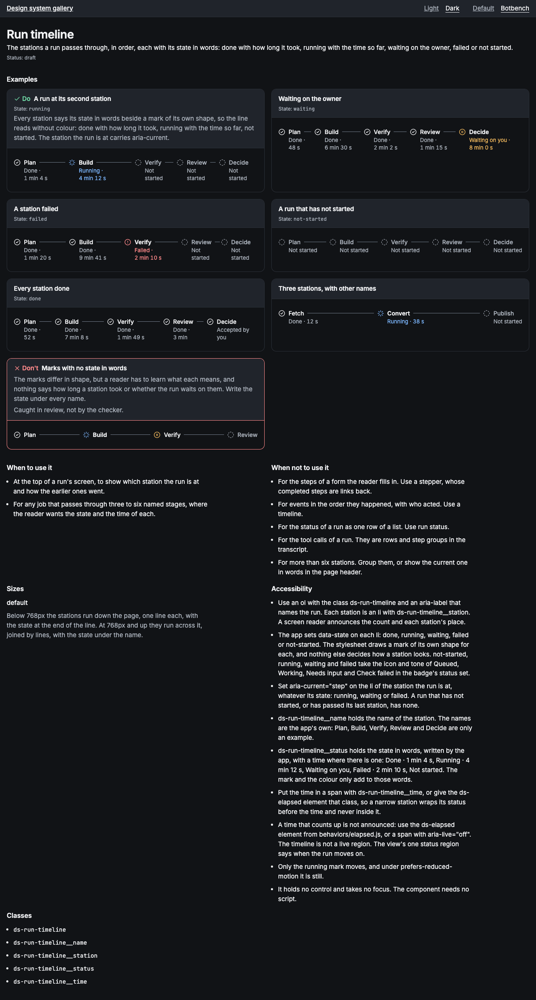
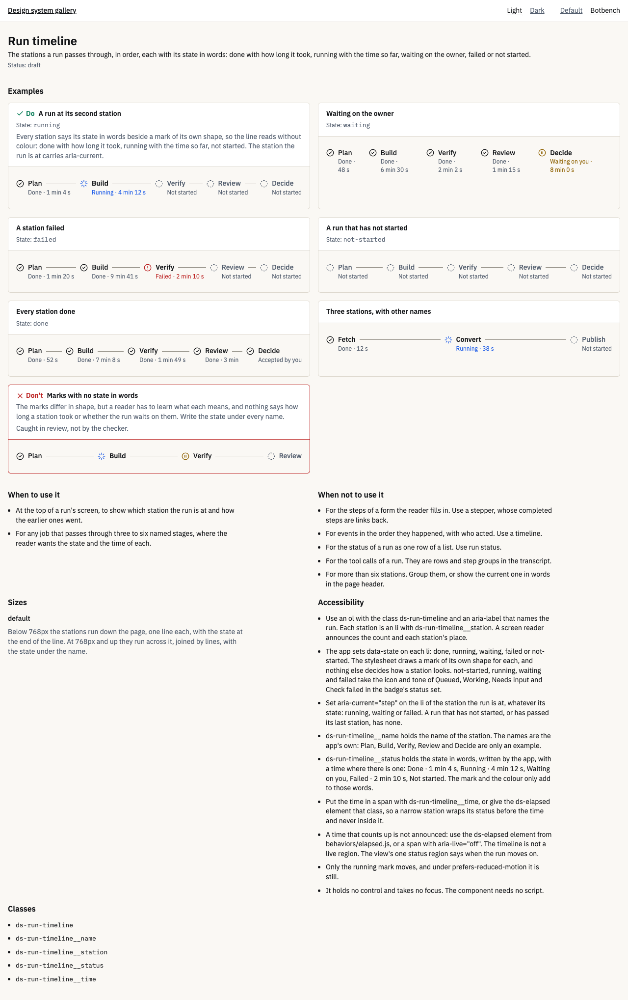
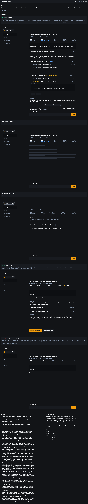

# Design system

A design system for apps whose interfaces are largely written by AI coding agents. It gives the agent a closed vocabulary of design tokens and components, and a checker that fails a frontend which steps outside that vocabulary. Screens come out consistent with each other and without the generic AI-generated look, and the look of every app that uses it can be changed in one place.

It is for a developer, or a coding agent, building web frontends: plain HTML, React or another framework. Version 0.7.7. Every component is still marked `draft`, and one app uses it so far. See [Status and limits](#status-and-limits).

## Why use it

- **Change the brand once.** A theme sets the values of the system's tokens: colours, radii, fonts and any other token. An app links the theme's stylesheet, and when the theme changes here, the app picks it up with its next sync, with no change to its own markup. Fonts and icons also live here and arrive the same way.
- **Enforcement, not advice.** The checker scans an app's CSS, HTML, JSX, TSX and class names in script, and a second copy of the structural rules runs on rendered pages from the app's end-to-end tests. It holds 41 rules: raw colours, off-scale sizes, unknown classes, gradients and blur, more than one primary action in a view, nested cards, badge clutter, emoji as icons, stock phrases and more. It exits 1 on findings, so it runs in the app's own test command.
- **Plain CSS classes on ordinary HTML.** A component is class names such as `ds-button ds-button--primary` on native elements. It works from React, another framework or none. There is no runtime dependency; seven optional script modules cover the few components that need behaviour.
- **Accessibility built in.** The build fails when a text pair is below 4.5:1 or a border or focus pair below 3:1, in light and dark, for every theme. Controls are at least 44px in both directions. Tabs, combobox, command palette, menu and listbox have keyboard behaviour, and every transition stops when the reader asks for reduced motion. The gallery is tested with axe.
- **Made for agent-built interfaces.** Agents read one short rules file ([`rules/core.md`](rules/core.md), under 2,400 characters), choose from a machine-readable index of every component, and copy the example markup. The catalogue has components for transcripts, tool calls, approvals, step groups, run timelines and long runs, and a page pattern for the screen of one agent run.
- **Evidence.** In a [blind-build trial](docs/trial-report.md) two agents that had never seen this repository each built three screens from a synced copy of version 0.3.0 alone; all six passed the static scan, the rendered rules and axe with no findings, waivers or declared gaps. An [independent audit](docs/audits/2026-11-22-independent-audit.md) of 0.7.0 approved it with conditions, scoring it between 3 and 7 out of 10 on ten dimensions; what it criticised is summarised under [Status and limits](#status-and-limits).

## A quick look

The catalogue holds 100 components and 8 page patterns (agent run, app shell, filter and results, master and detail, multi-step form, not found, settings page, sign in). Each lives in its own folder of three hand-written files:

| File | Holds |
|---|---|
| `<name>.css` | The styles, in the `ds.components` cascade layer, using tokens only. |
| `examples.html` | Labelled examples of every variant and state, with at least one do and one don't. |
| `meta.json` | Purpose, when to use it and when not, variants, sizes, states, accessibility notes and classes. |

This is the composer's default example, from [`components/composer/examples.html`](components/composer/examples.html):

```html
<form class="ds-composer">
  <label class="ds-composer__label" for="composer-default-prompt">Message Claude Code</label>
  <div class="ds-composer__row">
    <textarea class="ds-composer__input" id="composer-default-prompt" name="prompt" rows="1"></textarea>
    <button type="submit" class="ds-button ds-button--primary">Send</button>
  </div>
</form>
```

State comes from the element itself (`disabled`, `aria-busy="true"`, `aria-invalid="true"`, or a `data-state` attribute for agent activity), never from a class a script toggles, so the same markup works from any framework.

The gallery shows every component and pattern in every variant and state, with its guidance. `dist/` is committed, so no build is needed to see it:

```sh
git clone https://github.com/jon-lange/design-system.git
cd design-system
python3 -m http.server --directory dist
```

Open `http://localhost:8000/gallery/`. Add `?theme=dark` for dark mode and `?brand=botbench` for the Botbench theme; the gallery bar links to both. Icons do not load from a `file:` URL, so serve the folder.

The run timeline under the Botbench theme, dark and light:

<p>
  
  
</p>

<details>
<summary>The agent-run page pattern under the Botbench theme, dark (a tall full-page screenshot)</summary>



</details>

The browser tests write these screenshots to [`test/visual/screenshots/`](test/visual/screenshots/), one per page, width and mode.

## Use it in an app

The app takes a copy of `dist/` into its own repository. Nothing loads from another host and the app gains no dependency. The package is not published to npm. [`docs/consumer-guide.md`](docs/consumer-guide.md) has every step in full; this is the short form.

1. **Sync a copy.** With this repository checked out beside the app, run from the app's root:

   ```sh
   node ../design-system/scripts/sync.mjs --to vendor/design-system
   ```

   It copies `dist/` and writes `hashes.json`. Commit the folder and never edit it: the checker fails when a file in it has changed. Run the same command to update; it prints the components, patterns and rules that were added, changed or removed. `--check` writes nothing and prints one line when a newer version exists.

2. **Load the stylesheet.** In plain HTML, serve the folder and link it. Keep `fonts/` and `icons.svg` beside it.

   ```html
   <link rel="stylesheet" href="/vendor/design-system/design-system.css">
   ```

   With Tailwind 3, import the stylesheet from the app's entry and use the preset with preflight off:

   ```js
   import preset from "./vendor/design-system/tailwind-preset.js";

   export default {
     presets: [preset],
     corePlugins: { preflight: false },
     content: ["./index.html", "./src/**/*.{ts,tsx}"],
   };
   ```

   Write no rules in Tailwind's base layer. Tailwind emits preflight and base rules unlayered, and they would override the system's layered styles. The preset replaces every Tailwind scale with token names, so `bg-surface` works and `bg-indigo-500` produces nothing.

3. **Optionally load a theme and choose a mode.** Link the theme after the system's stylesheet, and set `data-theme` on the root element to `light`, `dark` or `auto` (follow the system setting). With no `data-theme`, the page shows light, or the theme's default mode.

   ```html
   <link rel="stylesheet" href="/vendor/design-system/themes/botbench.css">
   ```

4. **Run the static scan in the app's test command.** Add `design-system.config.json` (paths to scan, the app's class prefix, its gaps file and the vendored folder; see [step 3 of the guide](docs/consumer-guide.md#3-add-the-config-file-and-the-gaps-file)), then:

   ```json
   {
     "scripts": {
       "test": "node vendor/design-system/checker/check.mjs --config design-system.config.json && node --test"
     }
   }
   ```

   It exits 0 when clean, 1 on findings and 2 when it could not run, and ends with one summary line such as `0 findings, 0 waivers, 0 declared gaps, 4 files scanned, 41 rules`. The one exception to a rule is an inline `ds-waive` comment that gives a reason.

5. **Run the rendered check in the end-to-end tests.** The structural rules need the rendered page when the app composes it in script. With Playwright:

   ```js
   await page.evaluate(readFileSync("vendor/design-system/check-dom.js", "utf8"));
   expect(await page.evaluate(() => dsCheckDom(document.documentElement, { appPrefix: "app" }))).toEqual([]);
   ```

   Call it on each screen and again with each dialog, sheet, menu and popover open.

6. **Point the app's agents at the rules.** In `AGENTS.md`, `CLAUDE.md` or the like: read `vendor/design-system/rules/core.md` before any interface work; choose a component from `components-index.json`, then open that one entry in `components.json` (it is large, so search it); never edit `vendor/design-system/`. An optional Claude Code hook in `dist/hooks/` blocks edits to the copy and scans each edited file.

When no component fits, the app composes existing ones, and failing that builds its own under its own class prefix with tokens only and declares it in a gaps file, which every run prints. The guide also covers the behaviour modules, the `data-state` contract for agent activity, the React source files and upgrading from 0.5.

## Theming

A theme is one hand-written file, [`themes/<name>.css`](themes/botbench.css), that changes the values of existing tokens in light and dark. It cannot add a name, so every component, utility and checker rule works the same under it, and an app's markup does not change when the theme does. Its rules sit in the `ds.theme` cascade layer, after the default values and before app CSS.

The build stops, naming the theme, when it:

- sets a name that is not one of the 68 tokens;
- lacks light or dark values, or its dark and `auto` blocks differ;
- uses a colour that is not six-digit hex;
- fails any of the 53 foreground and background pairs in [`tokens/pairs.json`](tokens/pairs.json) in either mode: 4.5:1 for text, 3:1 for borders and focus rings.

A theme may declare a default mode. Botbench, the worked example and the one theme shipped, is dark by default. It maps the Botbench brand onto the system's roles: an amber primary action, warm paper and charcoal surfaces, a 6px medium radius, and its own colours for each status. The header of [`themes/botbench.css`](themes/botbench.css) lists the six brand values that were darkened for light mode to pass contrast, each with its ratio before and after.

To change the look of every app: edit the theme here, run `npm run build`, and each app runs its sync. The build writes four files per theme to `dist/themes/`: the stylesheet, the theme's name and default mode with the `theme-color` of each mode, a token block for an app's `DESIGN.md`, and the tokens as data. "[Themes](docs/consumer-guide.md#12-themes)" in the consumer guide has the details.

## What is in the repository

| Folder | Holds |
|---|---|
| `tokens/` | `tokens.css`, the single source of every token, and `pairs.json`, the contrast pairs. |
| `themes/` | Themes: token values only. |
| `base/` | Reset, typography, layout classes, focus ring, fonts and icons. |
| `components/` | 100 components, one folder each. |
| `patterns/` | 8 page patterns, built to the same contract. |
| `behaviors/` | Seven optional ES modules for an app without a framework (tabs, combobox, command palette, menu, listbox, elapsed time, transcript). |
| `react/` | Two TypeScript source files for a React 19 app: a busy button and a transcript-following hook. |
| `checker/` | The static scan and the structural rules. No dependencies. |
| `rules/` | Eight files agents read: `core.md` first, then principles, disclosure, the never list, content, choosing a component, checker rules and the review rubric. |
| `gallery/`, `hooks/`, `scripts/` | The gallery's own CSS and script, the optional Claude Code hook, and the build, sync and codemod scripts. |
| `docs/` | The consumer guide, the authoring contract, the trial report, the audit and the plans. |
| `test/` | Unit and browser tests, fixtures and the committed screenshots. |
| `dist/` | Generated and committed. This is what an app copies. |

`dist/` ships `design-system.css` (the whole system in one stylesheet), `tokens.css` and `tokens.json`, `components.json` (every entry with guidance and example markup), `components-index.json` (one short entry each), `manifest.json` (tokens, classes and rule IDs), `check-dom.js`, `checker/`, `rules/`, `themes/`, `behaviors/`, `react/`, `fonts/`, `icons/` and `icons.svg`, the Tailwind 3 preset with its types, `gallery/`, `hooks/`, the `migrate-prefix.mjs` codemod, `VERSION`, `LICENSE` and `NOTICE`.

### Commands

Node 24 or later. `npm install` fetches development dependencies only.

| Command | Does |
|---|---|
| `npm run build` | Regenerates `dist/` and prints the contrast report. Fails, naming the folder, when a component, pattern or theme breaks its contract. |
| `npm test` | Runs the unit tests, including the checker over every example and a check that the committed `dist/` matches a fresh build. |
| `npm run test:visual` | Runs the browser tests in the installed Google Chrome: axe, the structural rules and pointer-target checks on every gallery page at 390px and 1280px in light and dark, keyboard tests, and the screenshots. |

### Adding a component

Add a folder under `components/` with its three files and run the build; nothing else needs editing. [`docs/authoring.md`](docs/authoring.md) is the contract, and [`AGENTS.md`](AGENTS.md) has the rules for working in this repository.

## Status and limits

- **Version 0.7.7.** [`CHANGELOG.md`](CHANGELOG.md) says what each version holds and what an app must do to upgrade. 0.6.0 renamed the prefix and shipped a codemod for it; no version since has renamed or removed a class, token or rule.
- **Everything is `draft`.** All 100 components and 8 patterns. An app may use a draft, but it may still change.
- **One consumer.** Botbench is the only app that uses it so far.
- **Chrome only.** The browser tests run in Google Chrome. Nothing has been tested in Firefox, Safari or WebKit, or with a screen reader. The components rely on recent platform features: the Popover API, anchor positioning, invoker commands, `:has()` and `field-sizing`.

The [audit](docs/audits/2026-11-22-independent-audit.md) of 0.7.0 found five defects that 0.7.2 fixed (menu and listbox keyboard, colour scheme under a theme's default mode, reflow at 320px, wide tables, the command palette's no-match announcement), and 0.7.5 added the two React source files. These of its findings are still open:

- The screenshot tests do not compare against a baseline; a visual regression is caught only by a person looking.
- The checker does not check `data-state` values, accessible names, `alt` text or whether a badge's tone matches its word.
- There is no typed React component layer beyond the two source files.
- In the Botbench theme's dark mode the focus ring is the same amber as the accent, and the audit judged the theme's identity generic (brand distinctiveness 4 out of 10).
- The diff has no line numbers, and there is no review-decision component, log viewer or presence component.
- Sizes are built with `calc()` on tokens in places, which the checker does not limit, and type sizes are in pixels.
- The stylesheet is one 327 KB file (about 60 KB compressed) with no way to load part of it.

## Licence

Apache License 2.0. See [`LICENSE`](LICENSE).

The repository and `dist/` include IBM Plex Sans and IBM Plex Mono under the SIL Open Font License 1.1, and a subset of the Lucide icons under the ISC licence (some derived from Feather, MIT). [`NOTICE`](NOTICE) lists each with its source and licence text, and both files travel with every synced copy.
