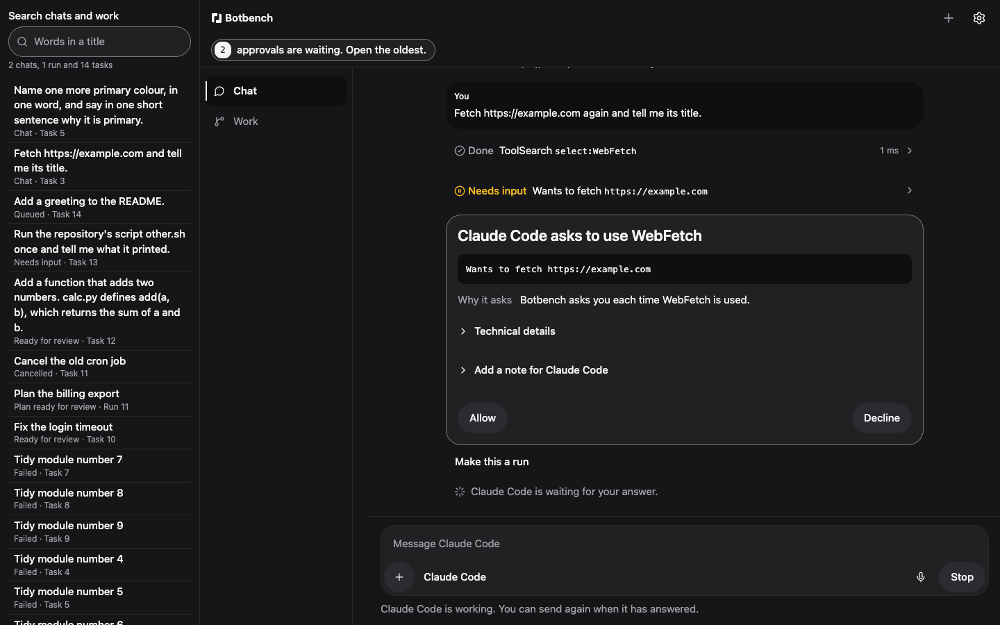
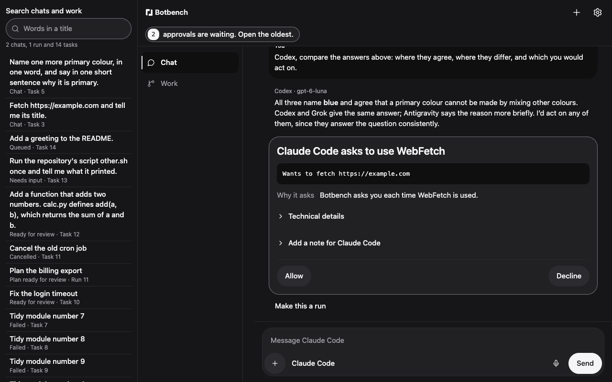
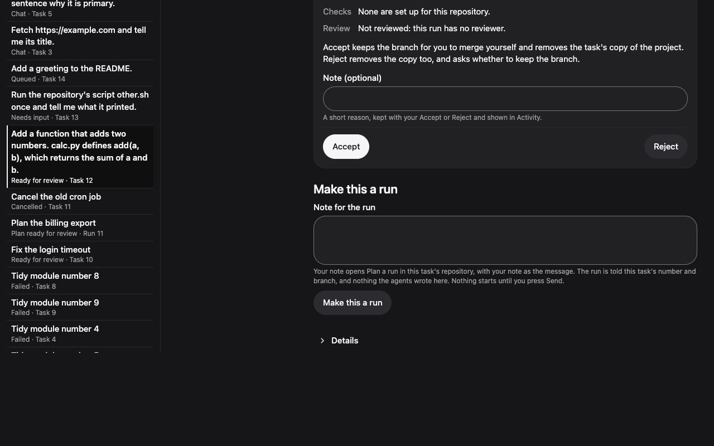

# Addendum to the audit against outside design skills, 23 November 2026

The [audit of 23 November](2026-11-23-skills-audit.md) lists seven things it did not do. This addendum does them, and says where each result confirms, corrects or adds to the audit. It changes nothing in the design system or in Botbench.

## How it was done

- **Botbench** at `fc34af8` (its `main`), with design system 0.11.4 vendored, its real server and its built client. Node 26.13.0, macOS 27.2, Apple M6, 16 GB.
- **Browsers**, through Playwright 1.65.1: the installed Chrome 156.0.8078.80 (headless), Playwright's Firefox 159.0 (build 1572) and Playwright's WebKit 27.2 (build 2388). Playwright's WebKit is WebKit for macOS with Playwright's patches. It is not Safari and not iOS Safari.
- **No model turn was run.** Every agent of the measured Botbench was a replay of a session captured from a real CLI run, through the driver contract, as Botbench's own tests do (`test/support/replay*.ts`). The server was started with `BOTBENCH_FAST_TESTS=1`, under which a real driver throws before it starts a turn.
- **What the measured Botbench held.** Put in the store through the engine before start, as `e2e/wide.e2e.ts` does: nine failed tasks, a task ready for review with its work committed, a run whose plan waits, a cancelled task. Then, through the running process's API and screens:
  - a task whose builder played the recorded turn that reads `calc.py`, edits it and replies (`refine-round.json`); it ended ready for review, with a transcript and a diff;
  - a task whose builder played the recorded turn that asks to run `sh other.sh` (`redrive-other-request.json`); its approval was left waiting;
  - a chat in which Claude Code's recorded fetch of example.com was allowed and answered, then asked again and left waiting (`chat-fetch.json`);
  - a chat that asked Codex, Grok and Antigravity one question and then asked Codex to compare the answers (`chat-turns.json`, `antigravity-acp.json`).
- **Two screens needed their own process**: a builder's question waiting on its card (`ask-question.json`; in the main one it queues behind the waiting approval), and Thread, which needs two paired workbenches (two real Botbench processes paired through their real routes, three questions sent and answered through the API).
- **The measuring script** (`measure-page.js`) reads what is drawn, as the audit's did: every control's box, each text node's size and weight by its characters, rows, line lengths by word positions, corner radii, sticky and fixed boxes, overflow.

Two limits of the measures, both found while doing the work:

- The first pass counted content inside closed `<details>` as drawn. All three engines keep boxes for it. The script now asks `checkVisibility()`, and every number here is from the pass after that fix. Before it, the chat screen's text read 3,862 characters; after, 2,991. The audit's own script was not available to check for the same error.
- Line lengths are counted by where each word starts. A long unbroken token (a path, a line of JSON) that wraps inside itself is counted on one line, so line lengths for mono text are not reported.

Scripts and raw output are in a scratch folder on the machine that ran them, outside both repositories (called the scratch folder below). The scripts import Botbench's engine and test support by path, so they are not committed here; the performance scripts move into Botbench with the transcript work, where their numbers are the "before". Nothing was added to either repository except this file and twelve screenshots.

## The short version

1. **The stream cost is real and it grows with the transcript.** One arriving event costs 14 ms of script at 500 events, 34 ms at 2,000 and 51 ms at 5,000. A keystroke in the message box costs 10, 26 and 40 ms. First render is not the problem: 189 ms at 5,000 events.
2. **With a real transcript, Accept is further away than the audit measured**: 1,781px down the page on a desktop and 2,101px on a phone, for a two-step turn. Allow, on the other hand, is in view on arrival in both a task and a chat.
3. **On a desktop the header is not sticky on a task.** After scrolling to the decision, the header is 827px above the window in Chrome and Firefox and 670px above it in WebKit. New.
4. **A chat's waiting approval is drawn in every chat.** The card for Claude Code's fetch appears at the end of the chat with Codex, Grok and Antigravity. New.
5. **Firefox and WebKit draw the screens as Chrome does.** Of 1,056 controls compared, none differs in WebKit and 12 differ in Firefox, each by one more line of wrapped text. No screen scrolls sideways in any engine.
6. **axe finds three rules broken**, one on every screen (`maximum-scale=1`) and two on every transcript (`role="log"` on the `<ol>`). No route change moves focus or changes the title, and a new reply is announced together with every tool row and the token count.
7. **The motion plan can rely on `@starting-style` for entrances in all three engines, and on nothing for exits outside Chrome.** A closing dialog or popover was kept drawn only in Chrome.
8. **Impeccable's detector found nothing in the source** (it says itself that a source scan is an undercount) **and 22 things on the drawn screens**, of which two rules are new to the audit.

## Corrections to the audit

Checked against the code by a separate pass, and again here where noted.

| The audit says | What is the case | Checked here |
|---|---|---|
| `disabled={busy}` in 50 places; busy buttons go against the system's busy-button contract | 31 occurrences, in 15 files. (52 if every `disabled={...busy...}` expression is counted.) The system's `BusyButton` is already used in `screens/turn.tsx`, for Send, Stop and the composer's chips. | `grep` in the worktree |
| "Older rows cannot be reached" at `screens/board.tsx:266` | The cap is on the server: `src/api/board.ts` sends the newest `FINISHED_SHOWN = 100` of Finished and of Chats, and `GET /api/board` takes only `hidden`, no cursor. | read |
| Send is `disabled` while invalid | Send is disabled only when a stop reason applies (`disabled={stopReason !== null}`, `turn.tsx:826`). With an empty message box it is enabled and drawn as the primary button. | read, and measured: on Chat with nothing typed, Send is 70×44, primary, not disabled |
| The Usage table loses its roles on a phone; data table is graded C | `screens/usage.tsx` follows the data-table contract (`ds-data-table`, its caption, its numeric cells). It has no `ds-data-table__scroll` wrapper, which the vendored documentation ties to the `ds-data-table--scroll` variant. | read. Measured: no sideways scroller at 1440; rows 46 to 47px; at 390 each row is a block of 135 to 179px |
| Work rows show state and number | A chat's row in the work column reads "Chat · Task 5" (`components/work-column.tsx:94` writes "Task" for anything that is not a run). With a task 5 in the same list, two rows read "Task 5". | seen in the accessibility tree and in the screenshots below |
| The review screen has a note field | It has two back to back (`screens/task.tsx` about line 517 and `components/decision.tsx` about line 148), and a third under them. | measured at 1440: "Your note" at 1,292px, "Note (optional)" at 1,695px, "Note for the run" at 1,927px |
| One event stream | Six places open their own `EventSource`: five screens (`turn`, `board`, `task`, `run`, `settings`) and the approvals provider. | measured: every screen opens two streams on load; one session of a sign-in and five route changes made nine stream requests |
| Allow and Decline are two identical grey chips | True in a chat. On a task's screen Allow is the primary button. | measured, section 2 |
| Accept is 1,284px down the page (1,494px on a phone) | The same seeded task measures 1,329px and 1,538px here. The difference of 44 to 45px matches the pending-approvals tray, which makes the header 97px tall where it is 53px with nothing waiting. | measured |

## 1. Impeccable's detector

### What the package is

`impeccable` 4.10.0 on npm is a 7 KB launcher (`cli/bin/cli.js`), with no install script. It runs a platform binary, `@impeccable/cli-darwin-arm64` 0.1.27: a 21 MB closed Mach-O executable. Its SHA-256 (`e3357834…82975b`) matches the manifest the npm package ships. If the binary is missing, the launcher downloads it from the project's GitHub releases and checks it against that manifest.

`detect` needs no account and no key. The binary does more than detect, though. Its strings name a sign-in, an account service at `api.impeccable.style`, "anonymous usage data" with `IMPECCABLE_NO_TELEMETRY` and `DO_NOT_TRACK` to turn it off, and saving a scan's counts to an account when signed in. Reading strings cannot show what a `detect` sends.

So it was not run through `npx`. The verified binary was run directly, inside `sandbox-exec` with all network denied, the home folder denied except for reading the Botbench worktree, its own empty home, and telemetry switched off. It ran to the end and wrote nothing to its home. **`detect` works as a local scan with no network.** What it would send with the network open was not observed.

### What it found

**On the source, as the audit asked** (`detect web/src`): exit 0, no findings. Its own note: "96 files scanned with regex matching only (.css, .ts, .tsx). Rules that need a parsed page (tiny-text, low-contrast and other element rules) did not run on them; findings are an undercount, not a clean bill of health."

**On the drawn screens.** The detector can read a page of a running Chrome through its local DevTools port (`--cdp`). Nine screens at 1280×800 and at 390×844, dark, with the sandbox opened to loopback only:

| Rule | Severity, category | Count | Where | In the audit |
|---|---|---|---|---|
| `side-tab` | warning, slop | 2 | Chat and Work at 1280: `a.ds-sidebar-nav__item::before`, a 2px stripe | Yes |
| `line-length` | warning, quality | 3 | Task with an approval at 1280: about 119 characters. Settings, This workbench: about 102 and 100 | Yes, measured |
| `first-viewport-column-overflow` | warning, quality | 2 | Settings, This workbench (one column 219% of the window tall beside one of 54%) and Usage (199%) at 1280 | **New** |
| `flat-type-hierarchy` | advisory, slop | 2 | Settings at 1280: body 15px, h1 17px, h2 17px, a step of 1.13 | Yes |
| `straggler` | advisory, quality | 13 | One word alone on a last line: Run (2 at 1280, 2 at 390), Settings at 390 (4, counted again on its workbench address), a task at 390 (1) | **New** |

7 warnings and 15 advisories. Chat, Work, a task ready for review, Permissions and Usage at 390 had none. The catalog has 62 rules: 31 "slop" (22 warnings, 9 advisories) and 31 "quality" (2 errors, 22 warnings, 7 advisories). No error-level rule fired.

**On the vendored design system folder** (`web/vendor/design-system`, not asked for, run because it was one command): 285 findings, all in the gallery's HTML pages and none in the stylesheet. 233 `cramped-padding` (113 of them in `gallery/index.html`), 28 `skipped-heading`, 14 `clipped-overflow-container`, 5 `em-dash-overuse`, 3 `flat-type-hierarchy`, 1 `low-contrast` (4.2 to 1, `#737373` on `#f3f2ef`, in `segmented-control.html`), 1 `repeated-container-text`. These were not triaged.

### What it changes

- **Confirms** the side stripe, the long lines and the flat hierarchy on Settings.
- **Adds** two rules the audit did not apply: a two-pane screen whose one column runs to twice the window, and single words left on a last line. `text-wrap: pretty` or `balance` answers the second; Firefox 159 does not support `pretty` (section 7).
- **Corrects** the instruction in the audit: `npx impeccable detect web/src` yields nothing on this codebase. The useful run is against the drawn page.

## 2. A transcript with a model's work

Chat and a task, each with real transcript content, in Chrome at 1440×900 and 1280×800 in dark and light, and at 390×844. Light and dark gave the same geometry on every screen but Settings, where the list of signed-in devices grew between passes. Screens: [chat with a transcript](2026-11-23/botbench-chat-transcript-1440-dark.png), [a task ready for review with its transcript](2026-11-23/botbench-task-transcript-1440-dark.png), [a task with an approval waiting](2026-11-23/botbench-task-approval-1440-dark.png), [the chat on a phone](2026-11-23/botbench-chat-transcript-390-dark.png).



### Layout

| Measure | Chat | Task |
|---|---|---|
| Transcript column | 688px at 1440 and at 1280; 358px at 390 | The same |
| Main pane | 908px at 1440, 748px at 1280 | 720px at both |
| Height the transcript gets | 646 of 900px at 1440; 546 of 800px at 1280; 511 of 844px at 390 | The page scrolls as one |
| Header | 97px with the approvals tray, 53px without | The same |
| Composer | 157px; 179px at 390, above a 58px tab bar | None |
| Height of the content | 1,714px of transcript for two short turns (2,242px at 390) | 2,173px in a 900 or 800px pane; 2,608px at 390 |

### Controls

| Screen, at 1440 | Controls | Heights | Under 44px |
|---|---|---|---|
| Chat, Claude Code, an approval waiting | 40 | 32×3, 38×2, 41×2, 44×15, 47×13, 68 to 112×5 | 7: the tray link (32), four tool-call rows (38 to 41), "Make this a run" (32), the agent chip (32) |
| Chat, three agents and a comparison | 34 | 32×3, 44×14, 47×13, 68 to 112×4 | 3: the tray link, "Make this a run", the agent chip |
| Task ready for review, with a transcript | 37 | 32×2, 38×2, 44×14, 47×13, 68 to 112×6 | 4: the tray link, two tool-call rows (38), "Copy" (32) |
| Task, an approval waiting | 31 | 32×1, 38×1, 44×11, 47×13, 68 to 112×5 | 2: the tray link, one tool-call row |

The 47px and most of the 68 to 112px controls are the rows of the work column: 48 to 113px tall, because titles wrap to between one and four lines. The 88px ones on a task are its note fields. A tool-call row is a `<summary>` 38 to 41px tall, the only new height the transcript brings.

### Type

Share of drawn characters, whole window at 1440 (the work column included):

| Screen | 15px | 13px | 12px | 22px | 28px | Weight 400 / 500 / 600 |
|---|---|---|---|---|---|---|
| Chat, Claude Code | 42% | 43% | 14% | 1% | 0 | 66 / 32 / 2 |
| Chat, three agents | 75% | 2% | 22% | 2% | 0 | 55 / 42 / 2 |
| Task with a transcript | 62% | 4% | 30% | 3% | 2% | 65 / 26 / 8 |
| Task, an approval waiting | 62% | 1% | 31% | 3% | 2% | 51 / 39 / 10 |

At 390, without the column, the chat with Claude Code is 62% 13px: mono, from one failed tool call whose output is drawn open. No text is under 12px on any screen. The sizes in use are still 12, 13, 15, 17, 22 and 28px.

### Rows and lines

| Row of the transcript | Height at 1440 | At 390 |
|---|---|---|
| Your message | 69 to 91px | 69 to 113px |
| A tool call, closed | 50 to 53px | 50 to 72px |
| A failed tool call, drawn open by default | 656px | 1,048px |
| The agent's reply | 61px (one line) to 218px (a reply with two lists) | 83 to 305px |
| The line for an answered approval | 77px | 77px |
| The approval card | 332px | 381px |
| End of a turn ("Worked for…") | 65px | 65px |

| Lines of prose, in characters | 1440 and 1280 | 390 |
|---|---|---|
| An agent's reply, 15px | 96 | 49 |
| Body text on a task, 15px | up to 102 | up to 51 |
| Field descriptions on a task, 12px | 115 to 123 | 58 to 64 |

Corner radii are the audit's three: 22px (message, approval card, composer box, diff), 10px (code, the tray's count, a navigation item) and the pill (every button and field).

### Where the buttons are

| Button | 1440×900 | 1280×800 | 390×844 |
|---|---|---|---|
| Accept, task with a two-step transcript | 1,781px down the page: 881px below the window | 1,781px: 981px below | 2,101px: 1,257px below |
| Accept, the same task with no transcript (the audit's case) | 1,329px | 1,329px | 1,538px |
| Allow, on a task | 445px: in view | 445px: in view | 593px: in view |
| Allow, in a chat | 1,648px down the transcript, drawn at 580px: in view | drawn at 480px: in view | 2,177px down, drawn at 446px: in view |
| Send, chat with nothing running | x 1,349, y 839: bottom right, primary | x 1,189, y 739 | x 299, y 725 |

A transcript of one message, two tool calls and one reply adds 452px above Accept on a desktop and 563px on a phone. Between the transcript and Accept come five 22px headings: Checks, Changed files, Main, Note for Claude Code and Your decision. A sixth, Make this a run, follows. Allow is not buried: a task puts the card above everything else, and a chat follows its latest row.

In a chat Allow (72×44) and Decline (86×44) are both the default grey button and nothing on the screen is primary while a turn runs. On a task Allow is primary.

### Two things seen that the audit does not have

**An approval that waits in one chat is drawn in every chat.** With Claude Code's fetch waiting in one chat, opening the other chat (Codex, Grok and Antigravity, in which Claude Code took no part) shows the same card at its end, with Allow and Decline live. `screens/turn.tsx:423` takes every pending approval marked as a chat's, without asking which chat.



**The make-a-run dialog changes size after it opens.** In Chrome its first frame is 480×96 at 352px from the top; once its content has loaded it is 480×449 at 175px.

### What it changes

- **Confirms** the 720px column (688px of transcript), the one control size, the three radii, the long lines, and Allow drawn as weakly as Decline in a chat.
- **Corrects** "the decision is 1,284px down": with any transcript it is 1,781px or more, and it grows with every row. And "an approval inside the transcript is under-weighted" holds for a chat only.
- **Adds** the row heights of a real transcript, the failed tool call that takes 656 to 1,048px open, the approval drawn in the wrong chat, and the dialog's change of size.
- **A live turn remains to be measured.** Replayed events arrive within milliseconds of each other. What the screen does while text streams over seconds (the working line, the clock, following the latest row, a reply that grows) was not observed.

## 3. Performance of the transcript

### How the long transcripts were built

`long-replay.ts`, a driver in the scratch folder, plays one chat turn through the driver contract. The unit it repeats is the events three real Claude Code sessions produced between their session line and their usage line, in order:

| Recording | Events kept |
|---|---|
| `chat-fetch.json`, session "allowed" | 3 tool calls, 3 results, 1 text (its permission pair left out) |
| `refine-round.json`, the refine turn | 2 tool calls (Read, Edit), 2 results, 1 text |
| `redrive-other-request.json`, attempt 1 | 1 tool call (Bash), 1 result, 1 text (its permission pair left out) |

15 events a unit: 6 tool calls, 6 results, 3 texts. Each repetition gets fresh tool-call ids (the recorded id plus `-r<k>`). `rate_limit` and `usage` events are left out. One attempt, one turn: the prompt, the recorded session line, then units until N events are stored. The turn then waits, plays 40 more events 250 ms apart, and ends. What is not real: the repetition, the id suffixes and the pacing. A run of 5,000 events from one model would hold longer text and more varied tools than this.

At 500 events the transcript is 170 KB of JSON, 236 rows; at 2,000, 682 KB and 936 rows; at 5,000, 1.7 MB and 2,336 rows.

### Method

Chrome 156, headless, 1280×800, no extensions. Script, layout and style time are Chrome's own accounting over the DevTools protocol (`Performance.getMetrics`), read before and after each step. Long tasks are from a `PerformanceObserver` in the page. Heap is read after a forced collection. The turn is still running throughout, as it would be while events arrive.

### First render

Loading Chat with N events already stored. Median of three loads.

| Events | Transcript fetched | Rows drawn | Script | Layout and style | Long tasks | Elements in the page | Height of the transcript | Heap |
|---|---|---|---|---|---|---|---|---|
| 500 | 14 ms | 40 ms | 26 ms | 13 ms | 0 | 5,611 | 45,610px | 7.3 MB |
| 2,000 | 20 ms | 88 ms | 65 ms | 38 ms | 1, of 64 ms | 22,111 | 181,469px | 17.8 MB |
| 5,000 | 22 ms | 189 ms | 138 ms | 92 ms | 1, of 160 ms | 55,111 | 453,188px | 38.5 MB |

Times are from the start of navigation. All rows arrive in one render: nothing is virtualised, so every row is in the page.

### Each event that arrives, and each key typed

40 events over the open stream, 250 ms apart. Then 20 characters typed into the message box, 150 ms apart. The idle cost (the working line's clock, once a second) is taken off.

| Events in the transcript | Script for one arriving event | All main-thread work for it | From the event to the next frame, median (95th) | Events of 40 that made a long task | Script for one keystroke | Idle main-thread work a second |
|---|---|---|---|---|---|---|
| 500 | 14 ms | 19 ms | 19 ms (29) | 0 | 10 ms | 5 ms |
| 2,000 | 34 ms | 39 ms | 42 ms (53) | 1 | 26 ms | 15 ms |
| 5,000 | 51 ms | 57 ms | 55 ms (85) | 19, longest 78 ms | 40 ms | 25 ms |

One pass at each size. An earlier single pass at 500 events gave 18 ms an event, so read these to within about 4 ms.

The same with Chrome's CPU throttle at 4:

| Events | Rows drawn | Long tasks at load | From an event to the next frame, median (95th) | Events of 40 that made a long task |
|---|---|---|---|---|
| 500 | 128 ms | 1, of 76 ms | 19 ms (23) | 0 |
| 2,000 | 354 ms | 1, of 283 ms | 70 ms (88) | 24, longest 75 ms |
| 5,000 | 655 ms | 5, longest 588 ms | 166 ms (199) | 40, longest 174 ms |

The throttle slowed loading 3 to 4 times, and the time from a stream event to its frame 1 to 3 times: not at all at 500 events. Treat this table as a direction, not as a phone.

React's profiler was not used: the production build has none, and a profiling build is a change to the client's build.

### What it changes

- **Confirms** "every stream event re-renders the whole screen", with a number: the cost of one event rises 3.6 times from 500 to 5,000 events, and at 5,000 events 19 of 40 arriving events block the main thread for more than 50 ms on this machine.
- **Adds**: a keystroke in the message box pays nearly the same cost, so typing lags while a long transcript is on the screen, whether or not anything is arriving. And the page does 5 to 25 ms of work a second doing nothing, for a clock.
- **Adds**: first render is fast enough at these sizes. Memoising rows fixes the cost of an event and of a keystroke; virtualising is about the 55,111 elements and the 38 MB, which matter on a phone more than here.
- These are the "before" numbers. The commands to run them again are at the end.

## 4. Firefox and Safari

Firefox 159.0 and Playwright's WebKit 27.2, at 1280×800 and 390×844, dark, on fourteen screens: Work, both chats, a task ready for review with and without a transcript, a task with an approval, a task with a question, Run, Settings, Settings at This workbench, Permissions, Usage, Sign in, Thread. Each was measured with the same script as Chrome.

### Console

| Message | Chrome | Firefox | WebKit | What it is |
|---|---|---|---|---|
| 401 on `/api/session` | every sign-in | every sign-in (not printed as an error) | every sign-in | The client asks who is signed in before anyone is. An error in the console on every first visit. |
| 404 on `/api/agents/<agent>/connect`, four on each Settings load | yes | yes | yes | The replayed agents of the measuring server have no sign-in defined. Not a finding. |
| "Refused to apply a stylesheet because its hash, its nonce, or 'unsafe-inline'…" | no | no | once a screen | Playwright's screenshot adds a stylesheet and Botbench's content security policy refuses it. Checked: none before a screenshot, one after. Not a finding. |
| Uncaught exceptions | 0 | 0 | 0 | |

### Layout against Chrome

| | Firefox 159 | WebKit 27.2 |
|---|---|---|
| Controls compared by name (1,056 across the screens) that differ by more than 1px in height or 2px in width | 12 | 0 |
| The cause | One more line of wrapped text. A work-column row is 90px where Chrome draws 68px (on six screens). The changed-file row of a task at 390 is 113.5px for 94px, so that page is 19px taller and Accept is at 1,557px for 1,538px. | |
| Screens that scroll sideways | 0 | 0 |
| Elements drawn outside the window | 0 | 0 |
| Text under 12px | 0 | 0 |
| Controls missing | 0 | 1: Settings has no "Allow notifications" button, since this WebKit has no push |
| Document taller than the window on a desktop task | 157px, as Chrome | 0 |

### Sticky header and composer

| | Chrome | Firefox | WebKit |
|---|---|---|---|
| Chat at 1280: header top, composer bottom, with the transcript at its latest row and at its first | 0 and 800, both | the same | the same |
| Chat at 390: header top, composer bottom, tab bar | 0, 786, 786 to 844 | the same | the same |
| Task at 390, scrolled to the end (1,764px): header top, tab bar | 0, 786 to 844 | the same | the same |
| **Task at 1280, scrolled to the end: header top** | **-827px** | **-827px** | **-670px** |

**On a desktop the header leaves the screen on a task.** It is `position: sticky` inside `.ds-app-shell`, a box 800px tall, which sits inside the scrolling `.ds-split-panel__detail` whose content is 2,173px tall. A sticky box holds only while its parent is in view. In Chrome and Firefox the document is also 157px taller than the window on this screen, so the whole application, the work column included, slides up by 157px and leaves an empty band at the bottom. WebKit does not have the second scroll. The navigation and the approvals tray go with the header.



### A dialog and a sheet in Botbench

"Make this a run" on a chat (a dialog) and "Add context" on the composer (a sheet), at both widths.

| | Chrome | Firefox | WebKit |
|---|---|---|---|
| Dialog opens as a modal; transitions on it | yes; none | yes; none | yes; none |
| Dialog after Escape | gone at once | gone at once | gone at once |
| First focus in the dialog | the `<dialog>` element itself | the same | the same |
| Sheet opens; transition | `translate`, 160 ms, from the trailing edge at 1280 (360×800) and from below at 390 (390×220) | the same | the same |
| Sheet after Escape | `display: none` at once | the same | the same |
| First focus in the sheet | Close | Close | Close |
| Eight Tab presses: focus reaches the page behind | never | never | never |
| Focus returns to the opener, opened with the mouse | yes | yes | **no**: to the transcript's scroller or the body |
| Focus returns to the opener, opened with Enter | yes | yes | yes |
| Wheel over the backdrop moves the chat behind | no | no | no |

WebKit, like Safari, does not focus a button when it is clicked, so a dialog opened with the mouse has nothing to return focus to.

### Safe area

`env(safe-area-inset-bottom)` and `-top` resolve to 0px in all three engines on this Mac, also with WebKit's phone emulation. The tab bar's bottom padding measures 0px, the sheet's 0px and the composer's 12px. The viewport meta carries `viewport-fit=cover` and `maximum-scale=1`. Whether the composer, the tab bar and the sheet clear a home indicator can be seen only on a phone.

### The audit's component trials, in three engines

On the design system's gallery pages, Botbench theme, dark.

| Tried | Chrome 156 | Firefox 159 | WebKit 27.2 |
|---|---|---|---|
| Press a primary button | Transform and scale stay `none`. Transition: `background-color, border-color, color`, 100 ms. The pressed colour is the hover colour. | the same | the same |
| Open a dialog with its button's `command` attribute | Opens. No transition on the dialog or its backdrop. | the same | the same |
| Close it with Escape | `display: none` in the same frame | the same | the same |
| Open a sheet | `translate` over 160 ms; settles as a 360px side panel at 1280 and a bottom panel at 390 | the same | the same |
| Close it | No transition | the same | the same |
| Focus after closing, opened with the mouse | the opener | the opener | the body |
| Focus after closing, opened with Enter | the opener | the opener | the opener |
| Tab eight times inside | Focus never reaches the page behind. It leaves the page for the browser's own controls and comes back. | the same | the same |
| Wheel with a modal dialog or sheet open | **The page behind scrolls 300px** | the same | the same |
| Arrow keys on tabs | Right, End, Home and Left (wrapping) each move focus and select. A tab is 44px. | the same | the same |
| Arrow down on the tree | Focus stays. No tree roles. | the same | the same |
| The switch | Changes state. The thumb transitions `inset-inline-start` (`left`) over 100 ms. | the same | the same |
| The spinner, motion allowed | `ds-spinner-turn`, 960 ms, `steps(8)`, on `::before`; four running on the page | the same | the same |
| The spinner, reduced motion | `animation-name: none`; nothing running | the same | the same |
| Hover a tooltip | Drawn 1 to 20 ms after the pointer arrives. Within 1.2 s the interest invoker has reopened it as a popover in the top layer. | Drawn in 11 to 30 ms, by the stylesheet's hover rule. Never a popover. | Drawn in 1 to 3 ms. Never a popover. |
| Focus a tooltip's control | Drawn within 19 ms | 34 ms | 11 ms |
| Escape with the tooltip shown | The popover closes and the stylesheet's rule draws the text again: **it stays** | It stays | It stays |

### What it changes

- **Confirms** every row of the audit's "Components, in a browser" table, now in three engines, and "a dialog or sheet scrolls the page behind it" where the document itself scrolls.
- **Corrects** two of them. "Focus returns to the button that opened it" does not hold in WebKit for a mouse. And the tooltip is not only without a delay: Escape does not dismiss it in any engine, because the stylesheet's `:hover` and `:focus-within` rules redraw what the popover closed.
- **Adds** the desktop header that is not sticky on a task, and the 157px second scroll in Chrome and Firefox.
- **Adds** that the three engines otherwise agree, to the pixel in WebKit. Work on layout and density does not need a pass for each engine. Work on overlays does.

## 5. The phone pass

Chrome at 390×844, with touch, two device pixels to the CSS pixel, each screen measured after its content had arrived (a named row, card or table, then three equal readings of the page 200 ms apart). The audit's Work and Run captures, taken before their lists loaded, are replaced by these. Screens: [Work](2026-11-23/botbench-work-390-dark.png), [Run](2026-11-23/botbench-run-390-dark.png), [Settings](2026-11-23/botbench-settings-390-dark.png), [Usage](2026-11-23/botbench-usage-390-dark.png), [Thread](2026-11-23/botbench-thread-390-dark.png), [a question](2026-11-23/botbench-task-question-390-dark.png).

| Screen | Page height | Controls | Under 44px | Text by size | Longest line of prose | Sideways scroll |
|---|---|---|---|---|---|---|
| Work | 844px | 18 | 1: the tray link, 323×32 | 15px 61%, 12px 38% | 41 | no |
| Run, its plan waiting | 1,305px | 12 | 3: the tray link; Edit, 53×32; Delete, 71×32 | 15px 66%, 12px 24%, 13px 9% | 59 at 12px, 54 at 15px | no |
| Settings | 5,204px | 26 | 4: the tray link; three 20×20 radios, each inside a label 65 to 102px tall | **12px 84%**, 15px 12%, 17px 2% | 79 at 12px | no |
| Permissions | 1,437px | 7 | 1: the tray link | 12px 62%, 15px 35% | 59 at 12px | no |
| Usage | 3,670px | 5 | 1: the tray link | 15px 85%, 12px 11%, 22px 4% | 54 | no |
| Thread | 1,381px | 9 | 0 | 15px 81%, 13px 8%, 12px 5% | 48 | no |
| Sign in | 844px | 4 | 2: the Token and Code segments, 174×34 | 15px 88% | 54 | no |
| Task ready for review, no transcript | 2,045px | 16 | 2: the tray link; Copy, 81×32 | 15px 54%, 12px 36% | 64 at 12px | no |
| Task, a question waiting | 1,437px | 12 | 0 | 15px 57%, 12px 30% | 58 at 12px | no |

No text is under 12px on any screen. No screen scrolls sideways and nothing is drawn outside the window. No label is cut with an ellipsis. Fields are 17px, so focus does not zoom the page. What wraps or breaks:

- **Work's filter**: four segments of 87×52px. "Needs you (4)" and "Finished (10)" wrap to two lines inside them.
- **Work's rows** are 92 to 136px each: a title of one to three lines, then a badge and facts that wrap to two lines ("Task 12 · No checks set up · repo-refine"). With four rows the screen is full.
- **The approvals tray** is one line at 323×32 for "2 approvals are waiting. Open the oldest." On Thread its sentence ("3 messages with the paired workbench wait for you…") wraps to two lines in a 358×46 pill and makes the header 110px.
- **A changed file's name breaks inside itself**: `src/login.ts` on four lines, as the audit found. In Firefox the same row is 19px taller.
- **Usage**: each table row becomes a block of 135 to 179px, and the page is 3,670px tall, 4.3 screens.
- **Run**: Approve is 884px down a screen 844px tall, of which the tab bar covers the last 58px. It sits under the plan and above the feedback field. Edit and Delete are the only 32px buttons with a 44px neighbour on the screen.
- **A task ready for review**: Accept at 1,538px, or 2,101px with a transcript.
- **Settings** is 6.2 screens of 12px helper text beside 44px selects.

The tray link is under 44px on every screen that has it. It is the one control that appears everywhere.

### What it changes

- **Confirms** the file name that breaks, the wrapping tray, and 12px as most of Settings (84% here, 87% in the audit's desktop section).
- **Completes** the audit's partial pass: Work and Run after loading, and Settings, Permissions, Usage, Thread and Sign in, which it did not have.
- **Adds** the filter labels that wrap, Usage at 4.3 screens, and Approve just below the fold on Run.

## 6. Accessibility tree

### axe-core

axe-core 4.14.1, in Chrome, on twelve screens (the eleven signed-in ones and Sign in) at 1280×800 and 390×844, dark and light: 48 screen states. Installed in the scratch folder only and evaluated into the page from its file.

| Rule | Impact | WCAG | Screen states | Elements | Where |
|---|---|---|---|---|---|
| `meta-viewport` | moderate | 1.4.4 (AA) | 48 of 48 | 48 | `maximum-scale=1` in `index.html` |
| `listitem` | serious | 1.3.1 (A) | 16 | 100 | Every screen with a transcript: its `<li>` rows sit in `<ol role="log">`, which is no longer a list |
| `aria-allowed-role` | minor | best practice | 16 | 16 | The same `<ol role="log">` |

No other rule failed on any screen: no contrast failure, no unnamed control, no missing label. axe could not decide the contrast of 392 elements across 36 states ("background could not be determined because it is partially obscured"), which it lists for review by eye and which were not reviewed. Sign in passes everything but the viewport rule.

### What the tree says, by situation

Accessibility trees were saved as Playwright aria snapshots (`out/a11y/*.yml` in the scratch folder).

**A route change.** Five were made: Chat to Work by the navigation, Work to a task by its row, the task to Settings by the gear, Back, and the task to a run by its row in the column.

| | Found |
|---|---|
| Document title | "Botbench" before and after all five |
| Focus after the change | the body in four of five. In the fifth it stayed on the row clicked in the column, which is not replaced |
| A live region that says where you are | none changed. (On arriving at Settings, four `role="status"` elements each said "Available": the agents' states, not the route.) |
| Skip link | none |
| First Tab stops on a desktop screen | the column's search field, then each of its 17 rows |
| Tab presses from the top of a task to Allow | 17 |
| The `<h1>` | right on each screen ("Work", the task's title, "Settings", "Run 11"). Chat's is "Chat", visually hidden |

**A dialog and a sheet.** Section 4 has the measures. Both are `<dialog>` opened with `showModal()`, named by their titles through `aria-labelledby` ("Make this a run", "Add context"). The page behind is inert: Tab never reached it. The dialog's first focus is the dialog itself, not its first field. Focus returns to the opener except in WebKit after a click.

**A new transcript message.** The transcript is `<ol role="log" aria-live="polite" aria-label="Transcript">`, with a `role="status"` line inside it while an agent works. The waiting approval in the chat was answered (Decline) and every change inside a live region was recorded until the reply stood on the screen. In one tick, into the polite log:

| Added | Characters |
|---|---|
| "Denied" | 6 |
| "Did not fetch" | 13 |
| "You denied this." | 16 |
| The tool-call row: "Denied WebFetch https://example.com You denied it. It was not run. Your note: …" | 126 |
| "What Claude Code was told, 1 line …" (inside a closed disclosure) | 203 |
| The reply, with its "Claude Code" label | 221 |
| "Worked for 26m 41s Tokens: 52362 in, 365 out" | 43 |

The status line "Claude Code is waiting for your answer." and the card were removed in the same tick. A screen reader set to read a polite log is handed the tool rows and the token count along with the reply, in document order, with nothing to tell the reply from the rest. Focus was on the body before the answer and after it: pressing Decline removes the card and the focus with it. Separately, the approvals tray (`aria-live="polite" aria-atomic="true"`) changed to "1 approval is waiting. Open it."

**The approval card.** An `<article>` named by its heading ("Claude Code asks to run a command", level 2), then the command as text, a list of facts (Folder, Why it asks, Claude Code's reason), a group "Add a note for Claude Code", and the buttons Allow and Decline. It is not in a live region; its arrival is announced only by the tray's sentence, which does not say what is asked. On a chat the same card sits inside the log.

### What it changes

- **Confirms** "no focus move, announcement or page title on navigation, and no skip link", by measurement, and "focus is lost" as a pattern: it is also lost after answering an approval.
- **Adds** the `role="log"` on an `<ol>`, which costs every row its list semantics (100 elements here), and the finding that the log announces everything it is given.
- **Not checked**: the audit's "Thread: no live region for new messages". Chat and Task have one; Thread was not tested for it.
- **Not done**: nobody listened. VoiceOver was not run, on a Mac or a phone, and no real phone was used. What a polite log is in fact read as, and in what order, is unknown.

## 7. Browser support stated from memory

Each feature was tested with `CSS.supports` or an interface check and, where that is not enough, a probe on a blank page that reads what the engine did two frames after the change.

| Feature | Chrome 156.0.8078.80 | Firefox 159.0 | WebKit 27.2 |
|---|---|---|---|
| `@starting-style`: an inserted element starts its transition from it | works | works | works |
| A `<dialog>` and its backdrop fade in from `@starting-style` after `showModal()` | works | works | works |
| A popover fades in from `@starting-style` | works | works | works |
| `transition-behavior: allow-discrete` on `display`, plain element: still drawn two frames after `display: none` | works | parsed, **does nothing**: `display` is `none` | works |
| `overlay` property | supported | **not supported** | **not supported** |
| A closing `<dialog>` kept drawn while it fades (`display` and `overlay` with `allow-discrete`) | works | **gone at once** | **gone at once** |
| The same without naming `overlay` | kept drawn, but under the page: no longer on top | gone at once | gone at once |
| A closing popover kept drawn while it fades | works | **gone at once** | **gone at once** |
| Anchor positioning (`anchor-name`, `position-anchor`, `anchor()`, `position-area`, `position-try-fallbacks`, `anchor-size()`): a box placed against its anchor | works | works | works |
| `interestfor`, `interest-delay` | supported | **not supported** | **not supported** |
| `popover="hint"` reflects as "hint" | yes | yes | yes |
| Container queries: size, the `cqi` unit, and style queries on a custom property | work | work | work |
| `field-sizing: content`: a textarea grows from 20 to 200px | works | works | works |
| `text-wrap: balance`: the last line widens from 117 to 199px | works | works | works |
| `text-wrap: pretty` | supported | **not supported** | supported |
| `interpolate-size: allow-keywords` and `calc-size()`: a height moving to `auto` | works | **not supported**: jumps to 100px | works |
| `::details-content`, `linear()` easing, same-document view transitions, scroll-driven animations, `:has()`, `@property`, `@scope`, nesting, `light-dark()`, `color-mix()`, `dvh`, `overscroll-behavior`, `scrollbar-gutter`, `text-box-trim`, `sibling-index()`, `closedby` on a dialog, `command` and `commandfor` | supported | supported | supported |
| `corner-shape` | supported | not supported | supported |

### What the motion plan can rely on

- **Entrances in CSS, everywhere.** `@starting-style` works in all three for an element, a dialog with its backdrop, and a popover. The dialog, menu, popover, tooltip and sheet entrances in the plan need no script.
- **Exits in CSS, in Chrome only.** The plan's line "most of this is CSS today (`@starting-style`, `transition-behavior: allow-discrete`)" is half right. A dialog or popover that closes disappears at once in Firefox 159 and in WebKit 27.2: neither has `overlay`, and Firefox does not act on `allow-discrete` for `display` at all. Every exit in the plan (dialog 150 ms, menu 110 ms, sheet 240 ms, toast) needs script outside Chrome: add a closing state, wait for the transition to end, then call `close()` or `hidePopover()`. Decide whether exits are an enhancement in Chrome or are scripted for all.
- **Height to `auto` (the disclosure, list insert and remove)**: Chrome and WebKit. Firefox needs a measured height or a grid-row transition.
- **Tooltip delay through interest invokers**: Chrome only. The 400 ms delay and "at once for the next one" need script, or a CSS `transition-delay` on the hover rule, in the other two.
- **Anchor positioning, container queries, `field-sizing`, `text-wrap: balance`, `linear()`, view transitions**: all three. The plan's "one breakpoint, add container queries" and collision-aware placement of overlays can be built on the platform.
- **Staggers by `sibling-index()`**: all three builds here.

These are the engines Playwright has on this machine. iOS Safari and the Safari that a reader has installed can be older than WebKit 27.2; that was not checked.

### Corrections needed in `docs/browser-support.md`

The file's engine versions match the ones measured here. Its "Platform features" table differs from the stylesheet and from the probes in these places. The file was not edited.

| Row | It says | The stylesheet and the probes say |
|---|---|---|
| `@starting-style` and `transition-behavior: allow-discrete` | Used by `sheet`. Works in WebKit and Firefox. | The stylesheet has no `transition-behavior` and no `allow-discrete` in any file. `@starting-style` appears once, in `sheet.css`, for the entrance. The sheet has no exit. The row should name `@starting-style` alone, and should not say `allow-discrete` works: in Firefox 159 it does nothing on `display`, and in both engines a closing dialog is gone at once. |
| Popover API | Used by `menu`, `context-menu`, `split-button`, `popover`, `tooltip`, `hover-card`, `button`, `dialog`, `sheet` | `popovertarget` is in the examples of `context-menu`, `hover-card`, `menu`, `popover`, `selection-basket`, `toolbar` and `split-button`; `popover="hint"` in `tooltip` and `hover-card`; `:popover-open` in six stylesheets. `button`, `dialog` and `sheet` use no popover: dialog and sheet open with `command="show-modal"`. `selection-basket` and `toolbar` are missing from the row. |
| Anchor positioning | `anchor-name`, `position-area`, `position-try-fallbacks`, `position-try-order`, used by five components | `position-area` is in those five. `anchor-name` and `position-anchor` are in `tooltip` only, `position-try-order` in `menu` only, `position-try-fallbacks` in `menu`, `popover` and `tooltip`. `anchor-scope`, which `tooltip` uses, is not listed. |
| `:has()` | 20 components | 22 stylesheets |
| `env(safe-area-inset-bottom)`, `dvh` | `composer`, `sheet`, `now-doing`, `selection-basket`, `command-palette` | The inset is used by `composer`, `sheet`, `now-doing`, `selection-basket`, `tab-bar`, `toast` and `agent-run`. `dvh` is used by `command-palette`, `log-viewer` and `app-shell`. `command-palette` does not use the inset. |
| `tooltip`, `hover-card` in WebKit | "Lost: opening on a long press, closing on Escape, and the top layer" | Closing on Escape is lost in Chrome too: the popover closes and the stylesheet's hover and focus rules draw the text again. |
| "What still needs a real iPhone": whether the page behind a modal sheet scrolls | open | On a desktop it does, in all three engines, where the document is what scrolls: a wheel moved the gallery page 300px behind an open modal dialog and sheet. Touch was not tried. |

## Still not done

- **A live model turn.** Every transcript here was replayed, so its events arrived at once. Text that streams, the working line, following the latest row, and what a real long run looks like were not measured.
- **A real run's length and mix.** The 500, 2,000 and 5,000 event transcripts repeat fifteen real events. Their rows are shorter and more alike than a real run's.
- **React's profiler**, and so which components account for the cost of an event.
- **A real phone.** No touch scrolling, no on-screen keyboard, no safe-area inset (it is 0px in every engine here), no momentum, no iOS Safari. Whether a sheet over a scrolling phone screen lets the page behind move under a finger was not tried.
- **Safari itself.** Playwright's WebKit 27.2 stood in for it. The installed Safari and iOS Safari were not run.
- **A screen reader.** VoiceOver was not run. Section 6 says what the tree offers, not what is spoken.
- **The 392 elements axe could not judge for contrast** were not checked by eye.
- **What Impeccable's binary sends with the network open.** It was only run without one.
- **Permissions with something always allowed.** The measured Botbench had no standing permission, so the rows with Take back, and the focus loss the audit reports there, were not seen.
- **Thread's live behaviour**: a new message arriving, and scroll to the latest.
- **Firefox and WebKit at 1440×900 and in light.** They were measured at 1280×800 and 390×844, dark.
- **Comparisons with other products** are still the reviewers' knowledge of them.

## Running it again

Everything runs from the scratch folder against a Botbench worktree with its dependencies installed and its client built (`npm ci`, `npm ci --prefix web`, `npm run build --prefix web`). The worktree's path is at the top of `common.ts`. `npx playwright install firefox webkit` once.

```sh
cd <the scratch folder>

# Section 3, the "before" numbers. Starts and stops its own Botbench for each size. About 8 minutes.
node perf.ts 500,2000,5000 1,4          # → out/perf.json, a line for each size on stdout

# Sections 2, 4, 5 and 6 share one Botbench, left running until cleanup-world.ts.
node make-world.ts                      # → world.json
node screens.ts chromium 1440,1280,390 dark,light
node screens.ts firefox 1280,390 dark
node screens.ts webkit 1280,390 dark    # → out/screens/<engine>-<screen>-<width>-<mode>.json and .png
node thread-question.ts                 # Thread and the question card, with their own processes
node tables.ts 'chromium-.*-1440-dark'  # the rows of the tables above
node compare-engines.ts                 # Firefox and WebKit against Chrome
node botbench-interact.ts chromium      # and firefox, webkit → out/interact-<engine>.json
node impeccable-cdp.ts                  # → impeccable-run/cdp-*.json
node a11y.ts                            # last: it answers the chat's waiting approval → out/a11y.json
node cleanup-world.ts                   # stops that Botbench and removes its data

# Sections 4 and 7, on the design system's gallery and on a blank page.
node trials.ts                          # → out/trials.json
node tooltip-escape.ts
node css-support.ts                     # → out/css-support.json

# Section 1, on the source, with no network.
impeccable-run/run.sh detect web/src
```
