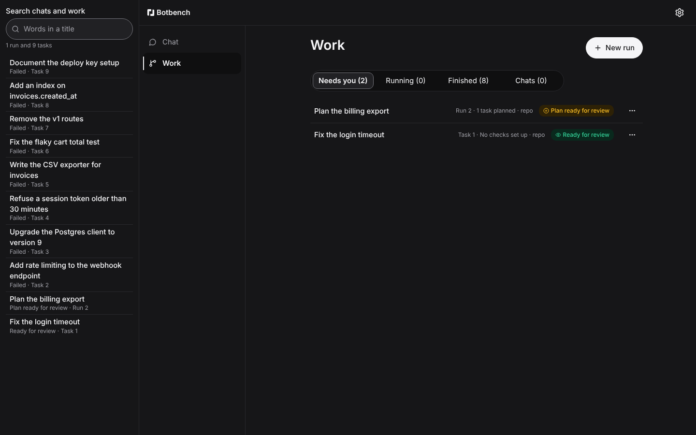
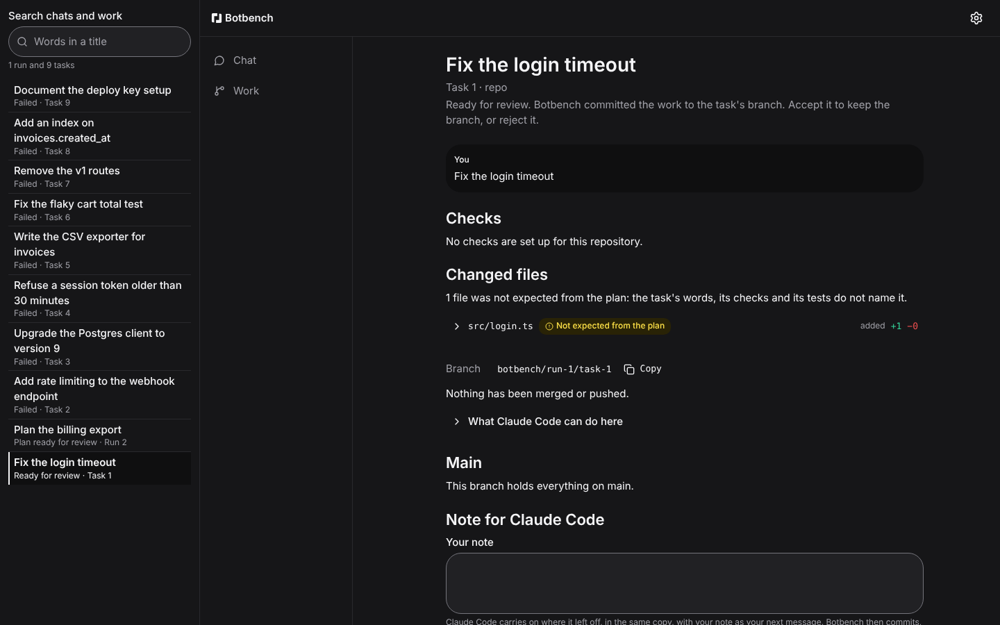

# Audit against outside design skills, 23 November 2026

An audit of the design system at version 0.11.4 and of Botbench, the one app that uses it, against four published sets of rules. The brief from the owner: nothing in the system is fixed, its own rules are not a defence, and the standard is the best product interfaces there are.

This is a list of findings and a proposed order of work. It changes nothing in the system.

## How it was done

Four reviewers worked separately, each with one lens, and none saw another's findings.

| Review | Rules applied | Evidence read |
|---|---|---|
| Visual and UX | Impeccable's critique and audit rubrics; the tells in Anthropic's frontend-design skill | Botbench's 16 real screens (`docs/images/` in its repository); this repository's gallery screenshots |
| Motion and interaction | Emil Kowalski's animation skills and audit template; Impeccable's and Vercel's motion rules | Every component's CSS, the behaviour modules, Botbench's client source |
| Code | Vercel's Web Interface Guidelines; Impeccable's 62 rules, applied by reading | Botbench's client source; the system's CSS and markup |
| Components | Radix, Base UI, React Aria, shadcn/ui, Material 3, Carbon, Primer, Geist; Linear, Raycast, Cursor, Claude and ChatGPT for agent surfaces | All 111 entries, on contact sheets of the gallery screenshots |

Sources, each read from its repository: [anthropics/skills](https://github.com/anthropics/skills) (frontend-design), [pbakaus/impeccable](https://github.com/pbakaus/impeccable), [emilkowalski/skill](https://github.com/emilkowalski/skill), [vercel-labs/web-interface-guidelines](https://github.com/vercel-labs/web-interface-guidelines), and [kuratlielia/arc-library](https://github.com/kuratlielia/arc-library) as a worked example of motion tokens.

A second pass then checked the reviews against the running product:

- **Botbench was run** (Node 24, its real server and built client, in Chromium) with a run and nine tasks made by its own engine, and every main screen was opened at 1280×800 and 1440×900 in light and dark, and four screens at 390×844. On each, a script measured what was drawn: the height of every control, every text size and weight by how much text uses it, row heights, column widths, line lengths, corner radii, and where the primary button sits. 48 measured screens.
- **Components were exercised in Chromium**: pressing a button, opening and closing a dialog, arrow keys on tabs and on the tree, the switch, the spinner under reduced motion, the tooltip's timing.
- **The proposed colours were run through the WCAG contrast formula.**
- **The design system's tests were run on Node 24** with its dependencies installed: 163 pass, 0 fail.
- **Six claims from the code review were checked again by hand** and held: `maximum-scale=1` in Botbench's `index.html`; Cmd/Ctrl+Enter as the only send key; `disabled={busy}` in 50 places; no use of `ds-skeleton` and no `memo` in Botbench; the switch's transition; no `touch-action` in the stylesheet.

### What this audit still did not do

- **Impeccable's own detector was not run.** The command was refused twice by the permission settings of the session that wrote this report. Its rules were applied by reading. To get the tool's own findings, run `npx impeccable detect web/src` in Botbench.
- **No transcript with a model's work was measured.** The machine had no vendor CLI, so the measured screens hold seeded work: a task ready for review, a planned run, and tasks that failed because no agent could start. The chat composer was measured in its "agent unavailable" state. The transcript findings rest on Botbench's 16 committed screenshots and on its source.
- **Firefox and Safari were not used**, nor a screen reader, nor a real phone.
- **Performance was not measured**; the re-render finding is from the code.
- **Comparisons with other products are the reviewers' knowledge of them**, not measurements.
- **The phone pass is partial**: chat, work, run and task. Its Work and Run captures were taken before their lists loaded and are left out.

## The short version

1. **The agent-run components are the best thing here** and are ahead of the open-source agent kits: tool call, step group, approval, run timeline, now-doing, check list. Keep them.
2. **The product's two largest problems are layout, not components.** On a desktop the content is a 720px column at any window width, and on the review screen Accept is 1,284px down the page. Both measured.
3. **There is almost no motion.** Colour transitions at 100ms, one sheet entrance, and spinners. Nothing has an exit, nothing has press feedback beyond colour. Seen in a browser.
4. **One control size makes the desktop look sparse.** 44px controls everywhere at a 22px radius, and the Work board shows two rows in a 900px-tall window.
5. **The product has no identity.** Grey with a monochrome pill. The earlier audit scored this 4 of 10; removing amber since then made it weaker.
6. **Four components need rebuilding** (diff, log viewer, tree, split panel) and the interactive overlays lack what headless libraries provide.
7. **Botbench re-renders the whole transcript on every event**, which will not hold for a long run.

## Measured on the real screens

Numbers from Botbench as drawn, at 1440×900 unless said. Screens: [Work](2026-11-23/botbench-work-1440-dark.png), [a task ready for review](2026-11-23/botbench-task-1440-dark.png), [Settings](2026-11-23/botbench-settings-1440-dark.png), [Chat](2026-11-23/botbench-chat-1440-light.png), [the task on a phone](2026-11-23/botbench-task-390-dark.png).

### Density

| Measure | Found | For comparison |
|---|---|---|
| Content column | 720px at both 1280 and 1440: half the window at 1440 | The inspector, diff and decision have no room beside it |
| Chrome before content | A 288px work column and a 220px navigation column that holds two links | 508px, 35% of the window |
| Work board, in view | 2 rows, with a 900px-tall window | The board's rows are 49px; about 14 would fit under the header |
| Text on the Work screen | 747 characters in the whole window | About half of it is the left column, which repeats the same work |
| The same work, twice | All ten items in the left column; two of them again in the board | One list |
| Row height, left column | 47 to 69px, because titles wrap to two lines | 32 to 36px with one-line titles |
| Control height | 44px (also 46 to 49px rows; 34px tabs; two 32px small buttons) | Nothing between 34 and 44, nothing compact |
| Controls under 44px | 2 of 21 on Chat; three 20px radios in Settings | The 44px rule holds almost everywhere, on a mouse-driven screen |

### The review screen

- **Accept is 1,284px down the page.** The window is 800 or 900px tall, so the decision is 384 to 484px below the fold on a desktop, and at 1,494px on a phone whose screen is 844px tall.
- The page is 1,676px tall for a one-file change with no checks: 1.9 screens.
- Five section headings at 22px, all the same weight, with one or two lines under each.
- Lines of prose run to 115 characters at 1440 and 92 at 1280.
- **On a phone the changed file's name breaks into four lines**, `src`, `/lo`, `gin`, `.ts`, because the "Not expected from the plan" badge takes the row's width.

### Type in use

| | Found |
|---|---|
| Sizes | 12, 13, 15, 17, 22, 28px |
| Share of text, task screen | 15px 68%, 12px 24%, 13px 4%, 22px 3%, 28px 1% |
| Share of text, Settings (This workbench) | **12px 87%**, 15px 10%, 17px 3% |
| Weights | 400 for most text, 500 widely, 600 for headings only |
| Page titles | 28px on Work, Chat, Run and a task; 17px on Settings |
| Radii | 22px, 10px and the pill |

Settings is the densest text in the product and nearly all of it is 12px helper text, in lines up to 110 characters, beside 44px controls: the type is too small where the controls are too large.

### Components, in a browser

| Tried | What happened |
|---|---|
| Press a primary button | No transform, no change of scale. The only transition is colour, 100ms |
| Open and close a dialog | Nothing on the dialog animates in or out. Focus returns to the button that opened it |
| Arrow keys on tabs | Move and select. The tab is 44px tall |
| Arrow down on the tree | Nothing. Focus stays, and the tree has no ARIA roles |
| The switch | Transitions `inset-inline-start`, 100ms |
| The spinner, reduced motion | No animation at all: the mark is still |
| Hover a tooltip | Shown within about 70ms: no delay |

## Scores

Impeccable's audit dimensions, 0 to 4:

| Dimension | Botbench | Design system |
|---|---|---|
| Accessibility | 3 | 3 |
| Theming | 3 | 3 |
| Responsive | 2 | 3 |
| Implementation integrity | 2 | 3 |
| Performance | not assessed | not assessed |

Nielsen's heuristics, out of 40: Botbench about 24, the design system about 28. The weakest are minimalist design, efficiency of use and, for Botbench, consistency.

Components: 15 graded A, 62 B, 30 C, 4 D. Botbench's nine screens graded between B and C on the code review; the full table is below.

## Findings: Botbench

### Layout and hierarchy

| | Finding | Change |
|---|---|---|
| P0 | **Desktop is a stretched phone.** Measured: 508px of columns, then a 720px content column at both 1280 and 1440, and the rest unused. | Three panes: sidebar 260px, transcript 720px, and a 360px inspector for checks, diff and the decision. Needs resizable panels. |
| P0 | **The decision is not the hero.** Measured: Accept sits 1,284px down a page seen through an 800 or 900px window, under Checks, Changed files, Branch, Main and a note field. | A decision dock that stays in view: fixed at the bottom on a phone, the inspector's footer on a desktop. |
| P1 | **The prompt is used as the page title**: three lines at 28px, with literal backticks, truncated, above a 22px card title that competes with it (`approval-card.png`). | A 20px title clamped to two lines, with code drawn as code. |
| P1 | **Work rows do not scan.** Titles wrap to four lines beside one line of metadata; a double ellipsis; five-line titles in the sidebar (`paired-question.png`). | One-line rows of 32 to 36px: status glyph first, truncated title, repository and age at the end in tabular numerals. |
| P1 | **Evidence is buried in prose.** A five-line caveat comes before the result, "1 of 1 check passed" appears three times, and lines run to about 110 characters (`ready-for-review-proof.png`). | Result first, lines capped near 68 characters, the caveat in a disclosure. |
| P1 | **An approval inside the transcript is under-weighted.** Allow and Decline are two identical grey chips while Send is solid. | Allow solid, Decline quiet, and the row tinted. |
| P1 | **A file name breaks into four lines on a phone** in Changed files, beside its badge. Measured. | Put the badge under the name below the breakpoint, and never break a path inside a segment. |
| P1 | **The same work is listed twice on a desktop**: all of it in the left column, and the current group again in the board, which holds two rows in a 720px column. Measured. | One list. The left column becomes the board, grouped, with one-line rows; the main pane shows the selected item. |
| P2 | **Shell details**: a navigation item clipped under the header (`permissions-check.png`); the pending tray is a sentence wrapping inside a pill on a phone; an empty sidebar state set as body text in a corner. | Fix each. |

### Behaviour and code

| | Finding | Where |
|---|---|---|
| Critical | **Pinch zoom is blocked** by `maximum-scale=1`. It is not needed: inputs are already 16px or more below the breakpoint. | `web/index.html:5` |
| Critical | **Every stream event re-renders the whole screen**: the event map is rebuilt and sorted, every row is called again and markdown is parsed again. No memoisation, no virtualisation. | `screens/turn.tsx:395`, `screens/task.tsx:195`, `components/transcript.tsx` |
| High | **No focus move, announcement or page title on navigation**, and no skip link. Every history entry reads "Botbench". | `app/shell.tsx:21-28` |
| High | **State is not in the address**: board filter, hidden view, open sheet, chosen attempt. Back does not close a sheet and scroll is not restored. | `screens/board.tsx:117,119` |
| High | **Older rows cannot be reached**: "the newest N of total" with no way to load more. | `screens/board.tsx:266` |
| High | **Only Cmd/Ctrl+Enter sends**, with no hint. | `screens/turn.tsx:606-611` |
| High | **No optimistic send.** The message appears and the box clears only after the server answers. | `screens/turn.tsx:508-544` |
| High | **Busy buttons are disabled**, so they lose focus, against the system's own busy-button contract. | 50 uses of `disabled={busy}` |
| High | **Loading is a spinner shown at once**, then the layout shifts. The skeleton component is not used anywhere. | all screens |
| High | **Focus is lost after Take back**, when the row and its button unmount. | `screens/trust.tsx:261-270` |
| High | **Dates, clocks and plurals are built by hand** in fixed English locales. | `screens/usage.tsx`, `components/task-status.ts` and others |
| Medium | Send is `disabled` while invalid, so a keyboard reader cannot reach it to learn why; no guard on unsaved edits; `autoFocus` on a phone; scroll targets land under the sticky header; offline is a banner with no retry. | see the code review |

### Screens

| Screen | Grade | Two worst problems |
|---|---|---|
| Chat | C | Re-render cost for each event; Enter does not send |
| Work | C | Filter not in the address; list capped |
| Run | B- | No guard on unsaved plan edits; spinner then layout shift |
| Task | C+ | Same stream cost; no anchors on a long screen |
| Thread | B- | No live region for new messages; no scroll to the latest |
| Permissions | C+ | Focus lost after Take back; dates in no chosen format |
| Settings | B- | Scroll target under the header; no feedback when a select saves |
| Usage | C+ | Fixed locales; table loses its roles on a phone |
| Sign in | B | Zoom blocked; `autoFocus` on a phone |

## Findings: design system

### Type

- The steps 15 to 17 are too close (1.13 times) to read as a hierarchy, and 22 and 28 are rarely used.
- There are no tracking tokens, so large system type sits loose. (A reviewer reported that weight 500 goes unused. Measured, it is used widely; the hierarchy problem is size, not weight.)
- Mono at 13px inside 15px prose reads small. Tabular numerals are used in tables only.
- Helper text at 12px carries most of the words on the settings screens: 87% of the text on one of them.
- Sizes are in px, so the reader's font-size setting is ignored.

Proposed scale for a desktop, one pixel larger on a touch screen:

| Role | Size / line height | Weight, tracking |
|---|---|---|
| micro: meta, table heads | 11 / 14 | 500, +0.02em |
| caption | 12 / 16 | 400 |
| dense: rows, sidebar, tables | 13 / 18 | 400 |
| body: transcript, 68 characters wide | 14 / 21 | 400 |
| title | 16 / 22 | 600, -0.01em |
| heading | 20 / 26 | 600, -0.015em |
| display: one on a screen | 26 / 30 | 600, -0.02em |

Inline mono at 0.93em. Tabular numerals on every duration, count and line total. Balanced wrapping on headings. Sizes in rem.

### Colour and surface

- **Eight status hues, three of them near amber.** Cut to five: working blue, passed green, failed red, needs-you amber, and one "outside" hue for peer and tainted. Queued, stopped and cancelled become neutral with a glyph.
- **Depth is one shadow.** Three levels would separate a card, a menu and a dialog.
- **Light mode leaves the transcript on bare grey.**
- **A card on the dark page needs a strong outline to be seen**, which reads as a wireframe.

A reviewer proposed a new palette. Checked against the contrast formula, parts of it fail, and one of its premises is wrong:

| Proposed | Result | Use in its place |
|---|---|---|
| Dark surfaces `#0E0E10`, `#131316`, `#18181B`, `#1F1F23`, `#26262B` | Adjacent steps differ by 1.08 to 1.09 to 1. Today's page and card differ by 1.13. **The proposed steps are closer together, not further apart.** | More steps help only with a top highlight or a border on each. Keep today's two and add depth with the shadow levels. |
| Dark text `#EDEDF0` and `#A0A0AB` | Pass on every proposed surface: 12.9 to 16.5 and 5.8 to 7.5 | As proposed |
| Dark third-level text `#6E6E78` | **Fails**: 3.0 to 3.8 | `#8C8C92` or lighter, which reaches 4.5 on the lightest surface |
| Dark borders `#232327` and `#34343A` | 1.05 to 1.56 against the surfaces: decoration only | A border that marks a control's edge needs 3 to 1: `#69696F` on the raised surface |
| Amber `#FFB224` on dark | Passes as text: 8.4 to 10.7. Dark text on it: 9.4 | As proposed |
| Amber `#B45F06` on light | **Fails** on the canvas (4.43) and the sidebar (4.17) | `#AB5A05`: 4.84 and 4.56 |
| Light input border `#D6D6DC` on white | **Fails** for a control's edge: 1.45 | `#94949A`, 3.02. Today's `#86868B` already passes at 3.62 |
| Light text on `#FBFBFC` and `#F4F4F6` | Today's `#1C1C1E` and `#636366` pass: 15.5 to 16.5 and 5.5 to 5.8 | Keep |

So the colour work is: an accent, fewer status hues and levels of depth. The neutral ramp does not need replacing.

### Size, density and shape

- **One control height, 44px, on every pointer.** The systems compared ship three or four. Proposed: 24, 28, 32 and 40px, with 44px applied automatically on a coarse pointer and the hit area extended there.
- **Three densities** set on a container: compact (28px controls, 13px text) as the desktop default for transcripts, tables and toolbars; comfortable; touch.
- **One radius, 22px, on everything**: cards, code blocks, dialogs, tooltips, a textarea whose resize grip sits in the curve. Proposed: 4 for badges, 6 for controls, 10 for cards and code, 14 for dialogs, a pill only for chips, segmented controls and Send. An inner radius is the outer minus the padding.
- **Spacing stops at 32px.** Add 2, 6, 20, 40 and 64.
- **One breakpoint and no container queries**, while Botbench adds a second switch in script at 1024px.

### Motion

What exists: colour transitions at 100ms, a sheet that slides in and vanishes on close, nine copies of a stepped spinner, a skeleton pulse.

Bugs found in it (the first, second, fourth and last were also seen in a browser):

- Sheet and dialog have no exit and their backdrops pop (`sheet.css:25-39`, `dialog.css:28`).
- The switch thumb transitions a layout property (`switch.css:74`); so does the progress fill, in WebKit only (`progress.css:49`).
- Nine separate spinner keyframes start when each mounts, so several loaders tick out of phase.
- The tooltip has no delay and flickers across a toolbar (`tooltip.css:54-62`).
- The tab indicator is drawn on each tab, so it cannot slide (`tabs.css:77`).
- A fourth toast is `display: none`: no entrance, no exit, no pause on hover (`toast.css:47`).
- Under reduced motion every loader stops, which reads as hung.

Proposed specification:

| | Values |
|---|---|
| Durations | 80, 120, 180, 240, 280 (overlay), 500 (sheet) ms |
| Easing, entering | `cubic-bezier(0.23, 1, 0.32, 1)` |
| Easing, moving on screen | `cubic-bezier(0.77, 0, 0.175, 1)` |
| Easing, leaving (opacity only) | `cubic-bezier(0.4, 0, 1, 1)` |
| Easing, sheet | `cubic-bezier(0.32, 0.72, 0, 1)` |
| Properties | transform, opacity, clip-path; height only for a disclosure; never `transition: all` |
| Press | `scale(0.97)`, 80ms in, 160ms out |
| Hover | in at once, out over 120ms |
| Menu, popover | `scale(0.96)` and opacity, 160ms in, 110ms out, from the trigger's corner |
| Dialog | `scale(0.96)` and opacity, 220ms in, 150ms out, backdrop fades |
| Tooltip | 120ms, after 400ms; at once for the next one |
| Sheet | 500ms in, 240ms out, drag to dismiss |
| Toast | rises and fades, swipe to dismiss, pauses on hover and focus |
| Disclosure | 200ms height and opacity |
| Tab and segment indicator | one pill that slides, 240ms; at once from the keyboard |
| List insert and remove | 200ms height and fade |
| Stagger | 35ms an item, six items at most, first load only |
| Exits | about 30% shorter than entrances |
| Stays instant | command palette, tree, option hover, navigation, the focus ring |
| Reduced motion | movement off; opacity and colour stay, at 120ms or less; a loader becomes a slow pulse |

For an agent at work:

- **Waiting**: one synchronised loader, a shimmer on the working verb, and the elapsed clock kept. A real number earns more trust than motion.
- **Text arriving**: each new block fades in over 150ms. Never a typewriter.
- **Tool calls**: the row rises 4px and fades in; on completion the spinner crossfades to a check and finished steps fold by height.
- **An approval arriving**: the one strong entrance. A 280ms rise, a border tint that decays, and the pending count ticking. Never a looping pulse.
- **A run finishing**: the station's check draws and the connector fills. The product's one authored moment.

Most of this is CSS today (`@starting-style`, `transition-behavior: allow-discrete`). Sheet drag, the sliding indicator, list reordering and the toast stack need script. Browser support for the newer features was stated from memory and must be checked.

### Touch and platform

- No `touch-action`, no tap-highlight colour, and `overscroll-behavior` in one place only. A dialog or sheet scrolls the page behind it.
- Only the bottom safe area is handled, on a page that covers the whole viewport.
- The data table's phone layout restyles table parts as blocks, which drops their roles in WebKit.
- A 2px accent bar marks the current row in list, combobox, command palette and table: Impeccable's `side-tab` rule.
- No `forced-colors` or `prefers-contrast` rules.
- The stylesheet is one 338 KB file.

### Tells of generated interfaces

Present: meta strings joined with middle dots; a tinted near-black standing in for black; one radius on everything; the side stripe; a flat type hierarchy. Absent: gradients, glows, eyebrow labels, icon tiles, nested cards. The copy is specific.

## Components

| Grade | Components |
|---|---|
| **A**, best in class (15) | activity-announcer, approval, badge, check-list, confirm-dialog, device-code, error-state, jump-to-latest, now-doing, option-picker, run-timeline, settings-row, step-group, tool-call, not-found |
| **B**, solid (62) | accordion, activity-feed, alert, attachment-chip, banner, breadcrumb, button-group, card, checkbox, context-list, copy-button, copy-field, dialog, disclosure, empty-state, feedback, field, file-upload, filter-chips, inspector, kbd, key-value, link, list, listbox, message, notification-list, number-field, otp-input, page-header, pagination, password-field, pending-tray, progress, radio, review-decision, run-status, search-field, selection-basket, show-more, skeleton, source-chip, sparkline, spinner, split-button, stat, stepper, suggestion-chips, switch, tab-bar, tag, textarea, timeline, toggle-button, toolbar, undo-toast, usage-meter, agent-run, filter-results, multi-step-form, settings-page, sign-in |
| **C**, dated or thin (30) | app-header, avatar, button, calendar, code-block, combobox, command-palette, composer, context-menu, data-table, date-field, editable-list, hover-card, icon-button, menu, popover, presence, reasoning, segmented-control, select, sheet, sidebar-nav, slider, streaming, tabs, tag-input, toast, tooltip, app-shell, master-detail |
| **D**, rebuild (4) | diff, log-viewer, split-panel, tree |

All 111 entries of `components-index.json` are in the table once. The counts are taken from the reviewer's row-by-row grades; its own summary line gave 61 and 31.

What the rebuilds need:

- **diff**: split and unified views, syntax colour, word-level marks, expandable context, collapse and "viewed" for each file, comments on lines, accept and reject for each hunk, keys for next and previous change.
- **log-viewer**: ANSI colour, line numbers and timestamps, search, collapsible groups, a follow toggle, virtualisation.
- **tree**: arrow keys and typeahead, one tab stop, selection, change marks with counts, a filter.
- **split-panel**: resize by drag and keyboard, limits, collapse, a remembered layout.

What the C grades share:

- **Overlays** (menu, select, combobox, popover, tooltip, hover-card): collision-aware placement, submenus, typeahead, shortcut columns, delay groups, entrance and exit.
- **Controls** (button, icon-button, tabs, segmented-control): a size scale, press and loading motion, a sliding indicator.
- **Agent surfaces** (composer, reasoning, streaming, code-block, command-palette): mention and command menus, paste and drop, a live thinking state, syntax colour with a copy button, nested palette pages with ranking.

### Missing, by value to Botbench

1. A prose renderer for agent text, safe while text is arriving. Botbench has its own, 396 lines.
2. A virtualised transcript.
3. Diff review across files.
4. Resizable panels.
5. A plan list: the agent's live plan above the composer.
6. Terminal output with ANSI.
7. A model and mode picker.
8. Mention and command menus in the composer.
9. A repository and branch switcher.
10. A shortcut registry with a help overlay.

Then: a context-window meter, citations, a toast stack, a drawer with snap points, charts for usage, message actions, an artefact panel.

## The system's own rules

| Rule | Verdict |
|---|---|
| Motion on colour and opacity only (`never.md`) | **Drop.** Press, origin and sheets need transforms. Keep "motion confirms a change of state". |
| Every transition zero under reduced motion (`base/reset.css`) | **Replace.** Movement off, opacity and colour kept. |
| One easing token | **Drop.** Entering, leaving and moving need different curves. |
| Every pointer target 44px | **Narrow** to coarse pointers. |
| One breakpoint | **Relax**, and add container queries for components. |
| Type sizes in px | **Drop** for rem. |
| No blur | **Keep.** One reviewer would allow 2px on a text crossfade; the others would not. |
| No bounce | **Keep.** |
| One shadow, on overlays only | **Revisit**, with three levels of depth. |
| Monochrome accent | **Revisit.** See identity. |
| Native select and date inputs | **Keep** on phones; add a rich select for a desktop. |
| Sentence case, specific copy, status in words | **Keep.** |
| The closed vocabulary and the checker | **Keep.** It is the system's distinction. |

## Where the reviewers disagree

- **A motion library.** The motion review says none: three small vanilla modules cover sheet drag, the indicator and reordering. The component review says adopt Motion with a React layer.
- **The stepped spinner.** One review calls nine out-of-phase copies a bug; another lists the spinner among the best components. Both can hold: the drawing is sound and the synchronisation is not.
- **Mobile input size.** An earlier pass reported inputs at 14 to 15px on a phone. The code review found 16 to 17px below the breakpoint (`field.css:31`), and the code review is right.

## Decisions for the owner

**1. Architecture.** The component review's verdict is that CSS classes on HTML are the wrong delivery for the interactive half: collision, focus scopes, typeahead, drag, virtualisation and exit transitions are what headless libraries exist for. It recommends about 35 React components on Base UI and React Aria that emit the same `ds-` classes, with the static two-thirds staying pure CSS and the checker carrying on. Its estimate is four to six weeks. What is lost: framework independence for interactive components and the zero-dependency stance, which Botbench's own rules require an ADR to change. The alternative is to stay CSS-first, add vanilla behaviours, and accept a lower ceiling on overlays, tables, tree and diff.

**2. Identity.** Three candidates, each cheap to try:

- An amber decision dock: one persistent place for the thing that waits on you, with keys for allow and decline. Nothing else is ever amber.
- A station glyph: Plan, Build, Verify, Review, Decide as a five-tick mark in every row, the tab title and the favicon.
- A boundary line: anything that leaves the Mac gets a dashed outline and an outbound glyph; everything inside is solid.

**3. Density.** Compact as the desktop default changes how every screen looks. It is the largest visible change after layout.

**4. Order.** Proposed below.

## Proposed order of work

**Phase 1: foundations, no architecture change.** Size scale and densities; the type scale, in rem; the surface steps and five status hues; the radius scale; motion tokens, the reduced-motion policy, press feedback, overlay entrance and exit in CSS, the switch and progress fixes, one synchronised loader; `touch-action`, overscroll containment and safe areas. In Botbench: remove `maximum-scale`, send on Enter, use the busy button, set the page title and move focus on navigation, and stop the file name breaking on a phone.

**Phase 2: Botbench's layout.** Resizable panels; the three-pane desktop with one list of work in place of two; the decision dock; one-line work rows; larger helper text on Settings; evidence with the result first; optimistic send; skeletons with a show delay.

**Phase 3: the transcript.** Memoised and virtualised rows; the prose renderer with highlighted code; block fade-in; tool-call and step-group collapse; the approval's entrance.

**Phase 4: the interactive layer**, by decision 1. Menu, select, combobox, popover, tooltip, toast, sheet, tabs.

**Phase 5: rebuilds and additions.** Diff review, log and terminal output, tree, data table; the composer with mentions and the model picker; command palette and shortcuts; the plan list.

**Throughout.** New checker rules as each lands (hand-written easing, `transition: all`, animated layout properties, the side stripe); Botbench-theme screenshots for every component; entries moved out of draft as they settle.
