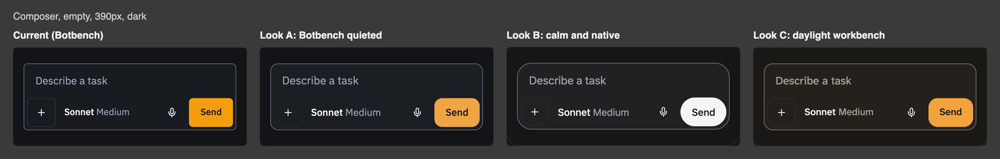
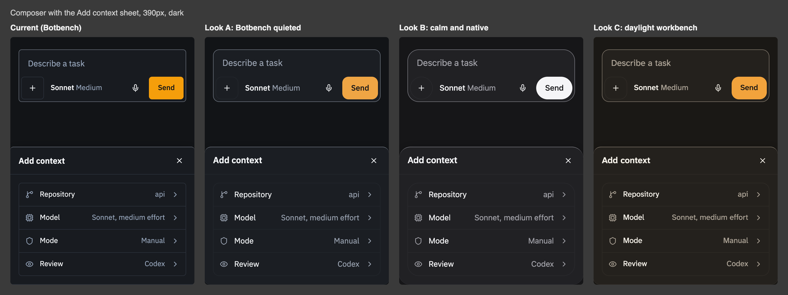
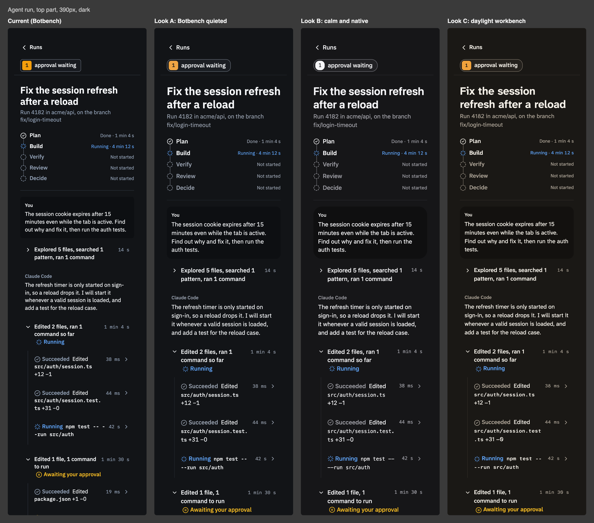
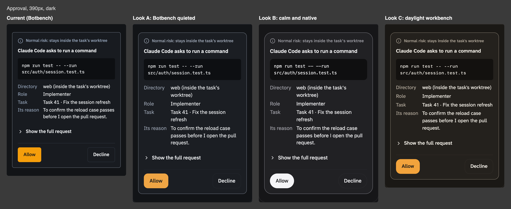
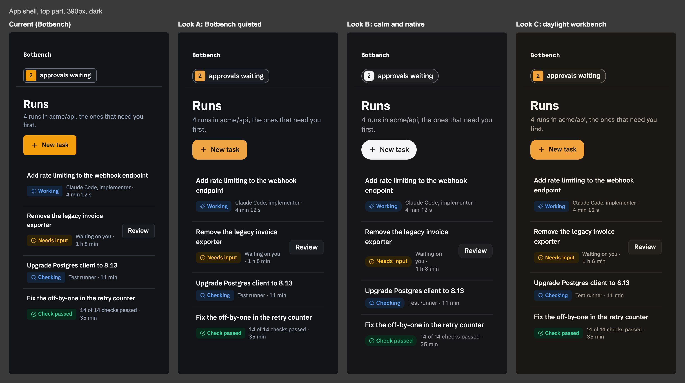
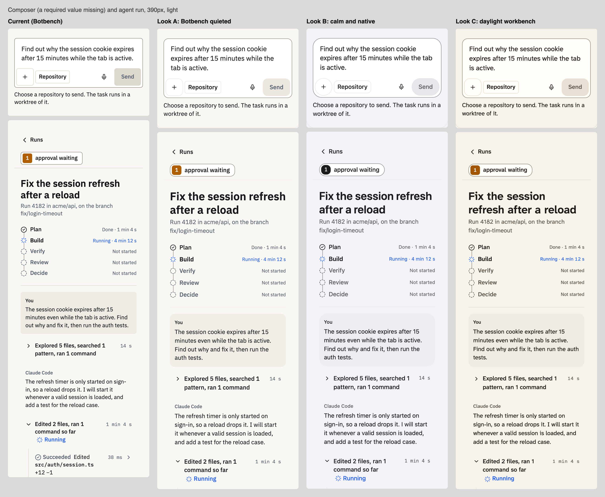
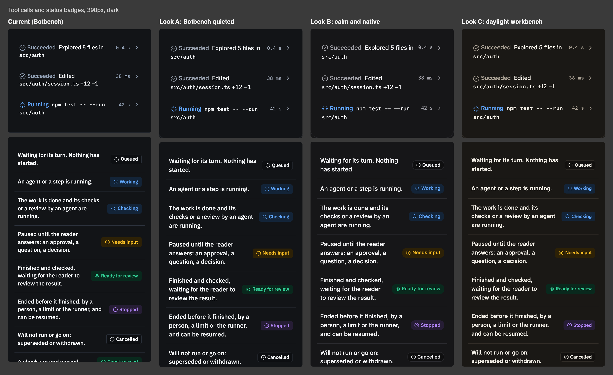

# Look options, November 2026

An exploration on the branch `explore/looks-2026`, at 0.7.7. Nothing here is a release. Three new themes, `themes/look-a.css`, `themes/look-b.css` and `themes/look-c.css`, change token values only, and each passes the build's contrast gate in both modes. Open any gallery page with `?brand=look-a`, `?brand=look-b` or `?brand=look-c` to see it. Look C's typeface is not in the repository, so the gallery falls back to IBM Plex Sans for it; the screenshots load the font from a scratch install (see "Fonts").

Every comparison image is a phone (390px) screenshot at device scale 2, current theme first.

## The current look, honestly

Botbench as it is: dark by default, amber primary, IBM Plex Sans and Mono, 14px body, 6px corners, 1px outlines.

**Colour.** The palette is sound. One amber for the one primary action, a charcoal page and eight status colours that each carry an icon and a word is the right structure, and it is not an AI palette: no purple, no gradient, no glow. Three things date it. The amber in dark (`#F59E0B`) is fully saturated and is the loudest thing on every screen, louder than the content. The charcoal greys lean blue (`#121417`, muted `#94A3B8`) while the amber and the light-mode paper are warm, so the two modes feel like two brands. And raised surfaces sit only one step above the page (`#181B20` on `#121417`), so the design leans on outlines to show where a block starts.

**Type.** Plex Sans is well drawn and does not read as a default, so keep it or replace it on purpose, not by drift. The problem is size: body text is 14px on a phone. Apple's default body size on iOS is 17pt and its minimum is 11pt (HIG, Typography); 14px reads small on a 390px screen, and long titles wrap early. Weights are right (400, 500, 600; nothing light), which matches the HIG's "avoid light font weights". Mono is overused: besides commands and paths, it sets every elapsed time ("1 min 4 s", "14 s"), the tool names and the app's wordmark. Times in mono, letter-spaced, beside sans text, are the most "developer tool" detail on the agent-run screen, and add noise without adding meaning.

**Disclosure.** Mostly right, and better than most current agent UIs. The composer shows one setting (the model) and puts the rest one press away in the Add context sheet, each row with its value: that is exactly the current pattern. The agent run keeps every step to one line with its detail behind it, and never hides a failure, an approval or the final answer. Two places still show too much. The run header on a phone stacks a back link, an approvals chip, the title, a subtitle and a five-row station list before the first message: about 400px of chrome before content. And inside an open group, each step line repeats its status word ("Succeeded Edited src/auth/session.ts +12 -1"); the icon and the group summary already say it, so the word could be visually hidden on success and kept for running, failed and waiting.

**Icons.** Lucide, 2px stroke on a 24px grid, round caps and joins (Lucide's icon design guide requires exactly that), drawn at 16px in buttons. They are current, consistent and none is decorative: each labels a control or carries a status beside its word. Two small notes. At 16px a 2px-on-24 stroke renders at 1.33px, which is fine; Apple's SF Symbols at body size read lighter, so a 1.75 stroke would feel closer, but that needs a build change, not a theme. And the `>_` terminal icon for Runs in the tab bar is the one icon that reads as a developer cliché.

**Cleanliness and noise.** Count the outlines. Composer empty: 2 (the block, the Add context button). Composer with the sheet: 8 (block, add button, sheet top edge, sheet header rule, list group, three row dividers). Approval card: 4 (card, divider above the buttons, Decline, plus the code block's fill). App shell on a phone: 8 (the approvals chip, header rule, three list dividers, the Review button, the tab bar's top rule and its active bar). Agent run, top part: about 12, plus the vertical group rules. The outlines that could go are the ones that repeat a fill: the composer block (its raised fill already separates it), the Add context button inside it, the list-group frame in the sheet (rows on a raised fill need dividers only), the approvals chip in the header, and the card outline on an approval that already sits on a raised fill.

**Would Apple ship this?** On structure, nearly: one primary action per view, 44px targets, native controls, a sheet for settings, disclosure with summaries that say what is inside. On restraint, not yet. Apple's own apps separate blocks with fills and space, draw at most one hairline between rows, give controls soft or capsule shapes, and set body text near 17pt on a phone. Botbench draws a 1px box around almost every block and control, at 14px, with 6px corners: it reads as a careful web dashboard, not as a native app. The HIG's layout page names "negative space, container shapes, or separator lines" as the ways to group; Botbench uses all three at once.

**Keep.** The composer as one block with Send inside it. The Add context sheet and its rows. One amber primary per view. Status = icon + word + tone. The step line and group summary rules. Lucide. The 44px target rule. No shadows on controls.

Sources checked: Apple HIG [Typography](https://developer.apple.com/design/human-interface-guidelines/typography) (iOS default 17pt, minimum 11pt; macOS 13pt and 10pt; "avoid light font weights"), [Buttons](https://developer.apple.com/design/human-interface-guidelines/buttons) ("Keep the number of prominent buttons to one or two per view"; a hit region of at least 44x44pt; "prefer circular or capsule-shape buttons", stated in the visionOS section), [Layout](https://developer.apple.com/design/human-interface-guidelines/layout) (group with "negative space, container shapes, or separator lines"), Lucide's [icon design guide](https://lucide.dev/guide/design/icon-design-guide) (24px canvas, 2px stroke, round joins and caps), and Linear's [redesign notes](https://linear.app/now/how-we-redesigned-the-linear-ui) (March 2024: less colour in the chrome, "reduce visual noise" in sidebar, tabs, headers and panels). The HIG's Materials page and Material 3's tonal-elevation pages could not be read; what this document says about tonal surfaces is judgement.

## Look A: Botbench quieted

**Idea:** the same amber, Plex and dark workbench, with faint outlines, rounder corners and a larger reading size.

| | Botbench | Look A |
|---|---|---|
| Accent | `#F59E0B` dark, `#AD5D02` light | `#EFA544` dark (same hue, less saturated), `#AD5D02` light |
| Surfaces (dark) | `#121417` / raised `#181B20` | `#121417` / raised `#1B1E23` (a clearer step) |
| Border | `#2B313B` dark, `#DDD8CE` light | `#22262C` dark, `#ECE8E1` light (near the surface) |
| Border-strong | `#646B76` | `#6A717C` (held at 3:1 by the pairs) |
| Radius | sm 4px, md 6px | sm 6px, md 12px |
| Typefaces | IBM Plex Sans, IBM Plex Mono | unchanged |
| Type sizes | ui 14, lg 16, xl 20, 2xl 24 | ui 15, lg 17, xl 22, 2xl 28; ui leading 1.45 |
| Default mode | dark | dark |

The quietest change and the safest: it is still Botbench, a step calmer. Blocks drawn with `border` soften (rows, list groups, the Add context button), but the composer, the approval card and the sheet edge are drawn with `border-strong`, which `tokens/pairs.json` holds at 3:1, so those outlines stay. That is the limit of what a theme can quiet.

## Look B: calm and native

**Idea:** the platform's own typeface, tonal filled surfaces, pill-shaped controls and a monochrome primary action.

| | Botbench | Look B |
|---|---|---|
| Accent | amber | `#F5F5F7` on dark with `#161618` text; `#1C1C1E` on light with white text. Focus ring a system blue (`#4C9DFF` / `#0066CC`) |
| Surfaces | blue-leaning charcoal / warm paper | neutral greys: dark `#161618` / raised `#212124` / sunken `#0F0F10`; light `#F2F2F7` / `#FFFFFF` / `#EDEDF1` |
| Border | `#2B313B` / `#DDD8CE` | `#29292D` / `#E6E6EB`, close to the raised fill |
| Border-strong | `#646B76` / `#8F8B81` | `#75757C` / `#86868B` |
| Radius | sm 4, md 6 | sm 10, md 22 (half of 44px, so every normal button is a pill) |
| Typefaces | Plex Sans, Plex Mono | `system-ui, -apple-system, …`; `ui-monospace, "SF Mono", …` |
| Type sizes | ui 14 … 2xl 24 | ui 15, lg 17, xl 22, 2xl 28 |
| Default mode | dark | dark |

This is the closest to the chat-app reference: the composer is one round block, Send is a solid white pill, the Add context sheet is a rounded tonal group. Adopting it means changing two rules: `rules/never.md` bans `system-ui` as the typeface and `rules/principles.md` says "Do not use San Francisco or any other system font". On Apple devices it renders SF Pro and SF Mono; on Windows Segoe UI; on Android Roboto, which the same rule bans by name. The amber leaves the interface entirely; if the amber is the brand, take Look A's four accent values into Look B. One cost shows in the approval queue: with no primary in a card, a secondary pill on a raised card is drawn only by a faint border, so Allow and Decline read as quiet buttons (see the needs list).

## Look C: daylight workbench

**Idea:** light first, warm paper and ink, set in Atkinson Hyperlegible Next and Mono, with Botbench's amber.

| | Botbench | Look C |
|---|---|---|
| Accent | `#F59E0B` / `#AD5D02` | `#F2A33C` dark, `#A05502` light (a shade deeper to keep 4.5:1 on paper) |
| Surfaces | blue-leaning charcoal / warm paper | warm both ways: light `#F6F3EC` / `#FFFDF8` / `#F0ECE3`; dark brown-black `#1A1815` / `#24211D` / `#13110F` |
| Border | `#2B313B` / `#DDD8CE` | `#2F2B26` / `#E6DFD2` |
| Border-strong | `#646B76` / `#8F8B81` | `#7D7468` / `#8C8273` |
| Radius | sm 4, md 6 | sm 6, md 14 |
| Typefaces | Plex Sans, Plex Mono | Atkinson Hyperlegible Next, Atkinson Hyperlegible Mono |
| Type sizes | ui 14 … 2xl 24 | ui 15, lg 17, xl 22, 2xl 28 |
| Default mode | dark | light |

The one with its own character. Atkinson Hyperlegible Next (2025) and its mono were drawn together for legibility, so code and prose sit as one family, and its open letterforms hold up at small sizes on a phone. The dark mode drops the blue from the greys, which ends the mismatch between a warm accent and cool neutrals. It changes the app's default mode to light, which is a product decision as much as a visual one.

## The comparisons

Composer, empty (dark):

Composer with the Add context sheet (dark):

Agent run, top part (dark):

Approval (dark):

App shell, top part (dark):

Composer and agent run in light mode:

Tool calls and status badges (dark):

What the images show plainly: tokens move colour, type, radius and the faint outlines, and they move them everywhere at once. They cannot remove the outlines drawn with `border-strong`, change which elements are boxed, or take mono off times. Those are the list below.

## What tokens cannot do: component changes

Each is one component and one change. None is needed for a look to work; each makes the chosen look land fully.

1. `composer`: `.ds-composer__box` draws no border (`border-color: transparent`) and relies on its `surface-raised` fill. Today it uses `border-strong`, which the pairs hold at 3:1.
2. `icon-button` inside `composer`: the Add context button is quiet (no border) with a `surface-sunken` fill and `border-radius: var(--ds-radius-full)`, so it is a round tonal button like the reference.
3. `button`: the secondary button fills with `surface-sunken` instead of `surface-raised`, so on a raised card it still reads as a button when its border is faint (visible in Look B's approval queue).
4. `approval`: the card outline uses `border` instead of `border-strong`; the elevated-risk card keeps its warning outline.
5. `context-list`: the group drops its outer border and keeps the row dividers, on a `surface-raised` fill.
6. `sheet`: the top edge uses `border` instead of `border-strong`; the radius on the top corners already follows `radius-md`.
7. `tool-call` and `step-group`: `.ds-tool-call__duration` and `.ds-step-group__duration` use `font-ui` with `font-variant-numeric: tabular-nums` instead of `font-mono`.
8. `app-header`: `.ds-app-header__name` (the wordmark) uses `font-ui` at the semibold weight instead of `font-mono`.
9. `tool-call`: the status word ("Succeeded") inside an open group is visually hidden on success and kept for running, waiting, failed and declined.
10. Base type: a phone body size. There is one `text-ui` for every width; Apple's defaults are 17pt on iOS and 13pt on macOS. Either add a 768px media query in `base/typography.css` that sets body to `text-lg` below it, or accept one size for both (these looks use 15px).
11. Icons: a 1.75 stroke needs `scripts/build.mjs` to drop the `stroke-width` attribute from the sprite and `base/` to set `stroke-width` in CSS. Lucide's own guide fixes 2px, so this is optional.
12. `tab-bar` (app content, not the system): the Runs tab's `terminal` icon could become a list or a play icon; this is the app's markup.

## Fonts

| Look | Typeface | Package and version | Licence | In the repository? |
|---|---|---|---|---|
| A | IBM Plex Sans, IBM Plex Mono | `@fontsource-variable/ibm-plex-sans` 5.3.0, `@fontsource/ibm-plex-mono` 5.3.0 | SIL OFL 1.1 | Yes, already in `base/fonts/` |
| B | the platform font (SF Pro, SF Mono on Apple) | none: not embedded, and Apple says "don't embed system fonts" | platform | Nothing to add |
| C | Atkinson Hyperlegible Next, Atkinson Hyperlegible Mono | `@fontsource-variable/atkinson-hyperlegible-next` 5.3.0, `@fontsource-variable/atkinson-hyperlegible-mono` 5.3.0 | SIL OFL 1.1 | No. For these screenshots they were installed in a scratch directory and loaded by an injected stylesheet |

Adopting Look C means: add both packages to `devDependencies`, add their `latin-wght-normal.woff2` files and `LICENSE` files to `FONT_SOURCES` in `scripts/build.mjs`, add two `@font-face` rules to `base/fonts.css` (each a variable file, weight 200 to 800), run `npm run vendor`, and decide whether Plex stays bundled for the default theme.

## Recommendation

Take Look B as the direction: it is the only one that answers "would Apple have something look like this" with a yes, because its calm comes from fills, round shapes and the platform typeface rather than from fewer pixels of the same boxes. Keep the amber if it is the brand, by putting Look A's accent values (`#EFA544` dark, `#AD5D02` light, and their hover and on-accent) into Look B, which keeps one recognisable colour for the one primary action. Do component changes 1 to 3 and 7 with it, because without them the composer and the secondary buttons keep the outlines that make the current look busy.

What adopting it takes:

- Change theme values: copy the token values of `themes/look-b.css` into `themes/botbench.css` (optionally with Look A's accent), so every app that already links `botbench.css` gets it on its next sync with no change of its own. Update the Botbench header comment and `README.md`'s Botbench paragraph.
- Change two rules: the "Inter, Roboto, Geist or system-ui" entry in `rules/never.md`, and the typeface bullets in `rules/principles.md`, to allow the platform font as the interface typeface.
- Add no font files.
- Four component changes (1, 2, 3 and 7 above), each a one- or two-line CSS change with its gallery screenshots re-recorded.

If instead the three looks stay as separate themes, `test/themes.test.mjs` pins the list of themes to `["botbench"]` and fails on a new theme name (every contrast pair of every look passes; only that list check fails). Changing Botbench's values in place avoids it.

## What was not verified

- The HIG Materials page and Material 3's tonal-elevation guidance could not be read (both render client-side); claims about tonal surfaces are judgement.
- Look B was seen only on macOS Chrome (SF Pro). It was not rendered on Windows, Android or Linux, where `system-ui` picks a different face.
- Screenshots are of gallery examples, not of the consuming app. The browser tests (`npm run test:visual`: axe, target sizes) were not run against the new looks.
- Whether a status colour is still told apart from Look B's white accent and Look C's deeper amber by at least 10 in CIEDE2000 was not measured; the build does not check it. Statuses are Botbench's own in every look.
