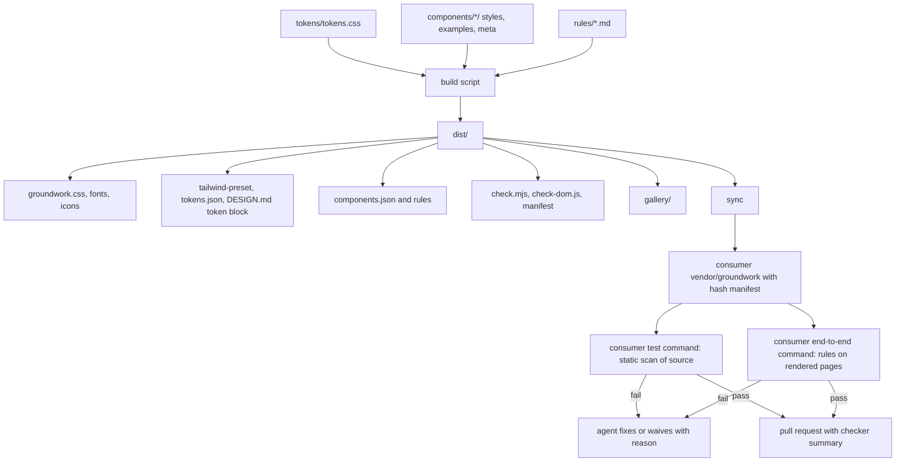
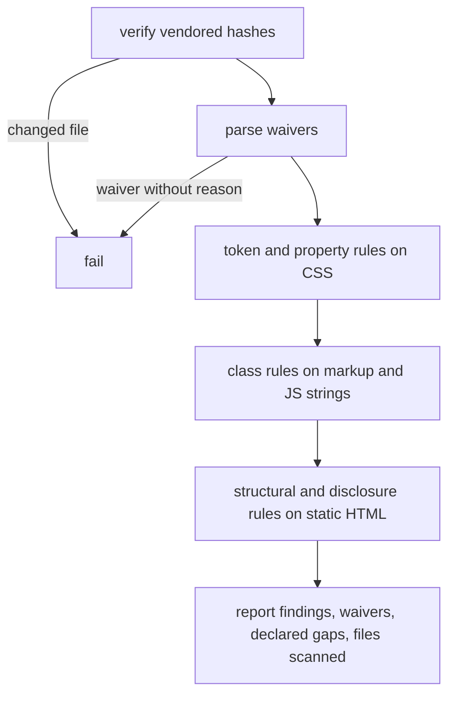

# Shared Design System - Plan

**Home repo:** `groundwork` (working name, new). File paths are relative to it unless a PR group names another target repo.

## Goal Capsule

- **Objective:** A screen an AI agent builds for any of the owner's apps comes out consistent with the others and free of the generic AI-generated look, without the owner correcting it by hand.
- **Means:** One repo holds a closed vocabulary of tokens and components, short rules, and a checker that fails any frontend stepping outside them (KTD1, KTD9, KTD19).
- **Authority:** This plan's Product Contract, then the owner's confirmed scope in conversation, then each consumer repo's own instructions for work inside that repo (Smelt's `CLAUDE.md` and `DESIGN.md`).
- **Execution profile:** Six pull requests. Five land in `groundwork`; one lands in `smelt`. Order and waits are on each PR group.
- **Stop conditions:**
  - Stop and ask before creating the GitHub remote or changing the working name.
  - Stop and ask if the Smelt work would break a Smelt hard rule or needs a change inside a Smelt feature branch someone else is working on.
  - Stop and ask if the default theme needs a value that contradicts Smelt's `DESIGN.md` "Never" list.
- **Who finishes:** The implementing agent opens each PR. The owner reviews the gallery and Smelt screenshots and merges.

---

## Product Contract

### Summary

Build a standalone design-system repo: design tokens with themes, a catalogue of about 95 components and page patterns, short agent-facing rules, and a zero-dependency checker. Smelt adopts it early, after a starter set of components, and has its existing screens rebuilt on the catalogue. Botdeck and Settleview adopt later, outside this plan, and their known constraints shape the design now.

### Problem Frame

Every app the owner runs has a hand-written stylesheet produced by whichever model built the screen. Botdeck and Settleview disagree on nearly every token name and on palette. Smelt has a third set, held in a `DESIGN.md` the owner wrote after an agent invented a direction he then replaced (`smelt/docs/lessons.md`, 2026-11-22).

Models converge on the same defaults when nothing constrains them: indigo gradients, cards inside cards, one spacing value, every control visible at once. Written guidance alone does little. A 2026 study of repository context files found no significant gain in task success and a 19–23% cost increase (arXiv 2602.11988). Banning one default also produces the next one: Anthropic notes that a model told to avoid Inter picks Space Grotesk.

A token palette alone does not fix this either. Smelt's screens today use only its tokens, and each one still assembles its own buttons, inputs and panels from utility classes. Smelt's plan named Nexvyn UI for shared components, and the licence check ruled it out (`smelt/NOTICE`).

### Key Decisions

- **Enforce with a closed vocabulary, not a ban list.** A ban list moves the model to the next default. Governs R2, R16.
- **Visual styling in a screen comes only from catalogue components.** Tokens alone still let every screen invent its own controls. Governs R14, R16.
- **Smelt's `DESIGN.md` is the default look.** The owner wrote it and Smelt adopts first. Apple's principles govern structure and behaviour, not appearance. Governs R3, R10.
- **Smelt's existing screens are rebuilt on catalogue components and may change appearance.** The owner chose this over preserving their current look. Governs R22.
- **Breadth is a goal.** The catalogue is measured against EasyUI's coverage and variant depth, with its decorative third excluded. Governs R6, R9.

### Requirements

**Tokens and themes**

- R1. One token vocabulary covers colour roles, type, spacing, radius, border, overlay elevation, motion, layering and fixed sizes, and every app uses the same names.
- R2. The vocabulary is closed: an app can change a token's value through a theme and cannot add a token name.
- R3. The default theme is Smelt's `DESIGN.md` values with IBM Plex in place of Geist, extended with the roles it lacks: status colours, a type scale, motion, overlay elevation and a dark variant.
- R4. Every theme ships light and dark values, and an app chooses which it enables.
- R5. A theme whose text and background role pairs fall below WCAG 2 AA contrast fails the build.

**Components**

- R6. The catalogue reaches about 95 entries across actions, inputs, navigation, layout, data display, feedback, overlays, disclosure, AI and approval surfaces, and page patterns.
- R7. Every component documents its variants, sizes and states, including empty, loading, error and disabled where they apply, and renders correctly at phone width.
- R8. Every component works as class names on plain HTML, with no framework dependency, from React, Alpine and hand-built DOM alike.
- R9. The catalogue contains no decorative component: nothing whose purpose is motion, glow, gradient or texture.
- R10. Interactive components are operable by keyboard and screen reader, and every pointer target is at least 44px, reached in dense rows through a padded hit area. Links inside running text are exempt.
- R11. Each component carries a status of `draft` or `stable`, and consumers may adopt drafts.
- R26. Every component shows a do and a don't example with the reason for each.
- R27. Layouts change between phone and wider screens at one shared width.

**Rules for agents**

- R12. The agent-facing core rules fit in about 400 tokens, and longer guidance loads only when the task needs it.
- R13. An agent can look up every component, its purpose, its markup and when not to use it from one machine-readable index before writing markup.
- R14. When no catalogue component fits, the agent builds an app-local component under the app's own class prefix using tokens only, and records the gap in a declared list.
- R15. Progressive disclosure is stated as checkable limits: one primary action per view, one advanced-settings disclosure per view, disclosure nested at most two levels, a text summary on every disclosure, and no critical action reachable only inside collapsed content. An action repeated for each item in a list, table or card set is never the primary action.

**Enforcement**

- R16. The checker fails a frontend that uses a raw colour, an off-scale size, a font outside the tokens, an unknown system class, an arbitrary Tailwind value, a visual utility class in screen markup, a banned visual pattern, or a breach of R15.
- R17. The checker reads CSS, HTML, JSX and TSX, class names inside JavaScript strings, and the rendered page.
- R18. No configuration switches a rule off. The only exception is an inline waiver that states a reason, and every run prints each waiver.
- R19. The checker runs inside each consumer's ordinary test and end-to-end commands, so it gates work from any agent or CLI.
- R20. A consumer's copy of the system is read-only, and a changed vendored file fails the check.

**Smelt adoption**

- R21. Smelt's Tailwind theme and the token block of its `DESIGN.md` are generated from the system, and a check fails when either differs from it.
- R22. Smelt's existing screens are rebuilt on catalogue components, with their behaviour and end-to-end tests unchanged.
- R23. Smelt takes no new runtime dependency, loads nothing from another host, and lists every copied file in `NOTICE`.

**Distribution and documentation**

- R24. A consumer receives the system as a versioned copy inside its own repo, updated by one deliberate sync that reports which rules and components changed.
- R25. A static gallery shows every component in every variant and state, in light and dark, at phone and desktop widths.

### Acceptance Examples

- AE1. **Covers R2, R16.** Given a stylesheet containing `color: #6366f1`, when the checker runs, then it exits non-zero and names the file, line, rule and the nearest token.
- AE2. **Covers R15, R16.** Given a rendered view with two primary buttons outside any repeated item, when the checker runs, then it fails with the one-primary-action rule and identifies both.
- AE3. **Covers R14.** Given an app-local class `sm-run-ledger` listed in the app's declared gaps and styled with tokens only, when the checker runs, then it passes and prints the gap in its summary.
- AE4. **Covers R18.** Given a waiver comment with no reason, when the checker runs, then the waiver is ignored and the checker reports the missing reason as its own finding.
- AE5. **Covers R20.** Given one byte changed in a vendored file, when the checker runs, then it fails before any other rule and names the file.
- AE6. **Covers R15.** Given a Delete button that exists only inside a closed `<details>`, when the checker runs, then it fails with the hidden-critical-action rule.
- AE7. **Covers R16.** Given a screen file containing `className="rounded-md border bg-surface p-lg"`, when the checker runs, then `rounded-md`, `border` and `bg-surface` are findings and `p-lg` is not.
- AE8. **Covers R15.** Given three approval cards in one view, each with Allow and Decline, when the checker runs, then it passes.

### Success Criteria

- Fresh agents given only the consumer guide build three specified screens that pass the checker with zero waivers and use only catalogue components, in at least two runs.
- The checker reports the expected rule on every page in a corpus of deliberately generic pages, and reports nothing on the gallery.
- Smelt's end-to-end suite passes after adoption with no visual utility class left in its screens.
- The owner approves the gallery screenshots for light and dark at phone and desktop widths.

### Scope Boundaries

**Non-goals**

- A React component package. Class names already work from React, and Smelt allows no runtime dependency without an ADR. Thin wrappers are copied into Smelt when a screen needs one.
- Copying Apple's look. No San Francisco font files, no Liquid Glass material, no replicas of Apple controls.
- Decorative components and animation showcases.
- A design-tool integration such as Figma.

**Considered and not built**

- A baseline mode that tolerates existing violations. Smelt's screens are rebuilt, so nothing needs tolerating. It becomes necessary when Botdeck or Settleview adopts, given their roughly 1,600 literal pixel sizes.
- An MCP server for component lookup. A static index serves one consumer. Evidence that would change this: agents repeatedly choosing the wrong component with the index available.
- An automated LLM judge. Smelt's `CLAUDE.md` already requires a self-critique pass, and this plan supplies its rubric. Evidence that would change this: unlintable tells reaching the owner's review more than occasionally.
- Style Dictionary or Terrazzo as a token pipeline. Hand-written CSS is the source, and one script derives the rest, including a token data file. A non-web consumer would change this.
- A dependency on Impeccable for generic tells. Its catalogue informs the rules, cited in Sources. A second tool would mean a second waiver syntax and a dependency Smelt would have to vendor.
- Per-component stylesheets and an `llms.txt` index. Smelt imports the bundle, and `components.json` is the one index. A consumer that needs to ship less CSS would change the first.
- A protected-files ledger that only the owner can edit. The checker's summary of waivers, gaps and scanned files goes into each PR instead. Evidence that would change this: a waiver or narrowed scan path reaching `main` unnoticed.

#### Deferred to Follow-Up Work

- Botdeck adoption, including wrapping its unlayered bare-element rules in a lower cascade layer first.
- Settleview adoption, including an alias map from its token names, an enumerated chart-safe token set, and a way to run the checker in a repo with no Node toolchain.
- A Tailwind 4 theme, when a consumer moves to Tailwind 4.
- Chart and data-visualisation colour tokens.
- Promoting app-local components declared during the trial and Smelt adoption into the catalogue.
- Publishing the gallery to a hosted URL.

### Open Questions

- **Deferred:** The working name `groundwork` and the `gw-` prefix. Renaming before the first tagged release is a find-and-replace; after Smelt adopts it also touches Smelt.
- **Deferred:** Whether Smelt enables the dark variant. The system ships it either way, and Smelt stays light-only until the owner decides.

---

## Planning Contract

### Key Technical Decisions

- KTD1. **Hand-written `tokens/tokens.css` is the single source of truth.** A build script derives the Tailwind preset, the `DESIGN.md` token block, a token data file in the Design Tokens Community Group format, the checker's allowlists and the component index. One author does not need a token toolchain.
- KTD2. **Every class is prefixed `gw-` and every custom property `--gw-`.** A fixed prefix is what lets the checker tell a system class from an app class in markup and in JavaScript strings. It also lets Settleview add system classes beside the 187 names its tests pin.
- KTD3. **Shipped colour tokens are six-digit hex, and dark values are selected by attribute and media query.** Settleview's charts read computed tokens and parse them as `#rrggbb` (`settleview/web/playchart.js`), so `oklch()`, `light-dark()` and `color-mix()` would break them. Alpha effects use dedicated tokens outside the chart-safe set.
- KTD4. **System CSS sits in named cascade layers: `gw.reset`, `gw.tokens`, `gw.base`, `gw.components`.** App CSS and Tailwind utilities are unlayered and therefore always win, which gives consumers an override path with no specificity contest. Tailwind 3.4.19 passes these layer names through untouched.
- KTD5. **A Tailwind consumer turns off preflight and writes no rules in Tailwind's `base` layer.** Tailwind emits both unlayered, so either would beat every layered component rule on the same property. `gw.reset` carries the border and box-sizing defaults that utilities assume.
- KTD6. **Component styles key off native state and ARIA attributes, never off classes that script must toggle.** `[open]`, `:popover-open`, `[aria-selected="true"]` and `[aria-current]` can be set by React, Alpine or a custom element, so one stylesheet serves all three.
- KTD7. **Behaviour comes from native elements first.** `<dialog>`, the Popover API, `<details name>` and invoker commands cover dialogs, menus, accordions and sheets without script. Light-DOM custom elements in one ES module cover the remainder. The gallery is their first consumer, since its accessibility tests need working tabs and toasts. React apps own that state themselves.
- KTD8. **Each component is one folder with three hand-written files: styles, example markup and a metadata file.** The build assembles the bundled stylesheet, the gallery and `components.json` from those folders, so no artifact is maintained twice. Don't examples in a folder double as failing fixtures for the checker.
- KTD9. **The checker is zero-dependency Node code that ships inside the vendored copy.** Smelt allows no dependency without an ADR, and a small auditable tool avoids one. It reads its allowlists from a generated manifest beside it.
- KTD10. **Tell rules are property bans plus structural rules.** Gradients, `backdrop-filter`, blur filters, `background-clip: text` and blend modes are findings whatever values they use, because all of them can be written with tokens only. The structural rules cover nested cards, identical card grids, centred body text, repeated primary buttons, emoji as icons, excess badges and stock phrases.
- KTD11. **Structural and disclosure rules run on a document tree, and the rendered page is the authority.** Static HTML is parsed into the same tree. In a framework app the rules run in the browser during end-to-end tests, where component composition and lists are already resolved. A view is the rendered document, and each open dialog or sheet is its own view. A critical action is marked `data-gw-critical`.
- KTD12. **The Tailwind preset targets Tailwind 3 and sets every theme key that carries a scale.** A preset replaces only the keys it names, so animation, blur, opacity, layering, transitions and letter spacing are set to token values or emptied. Values are `var(--gw-…)` references, so a theme change needs no rebuild; colour opacity modifiers are given up as a result.
- KTD13. **Distribution is a vendored copy with a hash manifest.** Smelt and Settleview both serve pages under `default-src 'self'`. Integrity is a blocking offline check. Freshness against the source repo is an advisory message.
- KTD14. **The test and end-to-end commands are the gate; the Claude Code hook is a faster feedback loop on top.** Smelt drives Claude Code, Codex, Gemini CLI and Grok, and only one of them runs Claude hooks.
- KTD15. **IBM Plex Sans and IBM Plex Mono are the default typefaces, shipped as vendored font files under the SIL Open Font License.** The owner banned Geist, which Smelt's `DESIGN.md` used. No-build apps need the files, and Smelt drops its two Geist packages.
- KTD16. **Icons are a curated subset of Lucide under the ISC licence, shipped as one sprite and as single files.** Markup references the sprite. CSS-drawn indicators such as a select chevron need single files, because a sprite symbol cannot be a CSS mask.
- KTD17. **Minimum browsers are Safari and iOS 26.2 and current Chrome and Firefox.** Core styles use only widely available features. Anchor positioning and customisable `<select>` sit behind `@supports`, and nothing depends on `interpolate-size`, which only Chrome ships.
- KTD18. **No component relies on an inline `style` attribute.** Both consumers' content security policies block it. Data-driven sizes use native `<progress>` and `<meter>`, or a documented custom property set through script. The checker allows a script-set `--gw-` property and nothing else inline.
- KTD19. **Screen markup may use utility classes for layout, spacing and sizing only.** Colour, border, radius, shadow and type utilities are findings outside a declared app-local component. This is what makes the catalogue mandatory in a Tailwind app (R16).
- KTD20. **One breakpoint, 768px, separates compact from regular layouts.** A custom property cannot appear in a media query, so the value is written literally, recorded in the manifest and the Tailwind `screens` key, and any other media-query width is a finding. Bottom tab bar shows below it and sidebar navigation at or above it.

### High-Level Technical Design



The static scan decides in a fixed order, so a failure early in the list is never masked by a later one:



### Output Structure

```text
groundwork/
  tokens/            tokens.css, contrast pairs
  base/              reset, typography, layout primitives, fonts, icons
  components/<name>/ <name>.css, examples.html, meta.json
  patterns/<name>/   page-level compositions, same three files
  behaviors/         light-DOM custom elements, one module
  rules/             core.md, principles.md, disclosure.md, never.md, content.md,
                     choosing-components.md, review-rubric.md
  checker/           rule sources and fixtures
  scripts/           build, sync
  dist/              committed build output, the only directory a consumer copies
  test/              unit, visual, fixtures, trial
  docs/              plans, authoring and consumer guides
```

### Sequencing

The checker lands before any component so that every component is written under it. Smelt adopts after a starter set of 21 components, not after the full first wave. The authoring contract, the cascade layers and the checker then meet a real React and Tailwind app while a change to any of them costs 21 components, not 61. Smelt also keeps gaining screens built from utilities, and each one is a later rebuild. The remaining waves follow adoption, and the long-tail wave runs in parallel with it.

### Risks

| Risk | Consequence | Response |
|---|---|---|
| The checker's parsing misreads valid CSS or JSX | False findings train agents to waive | U4 runs the scanners over Smelt's current `web/src` as a characterisation corpus, and every false finding becomes a fixture |
| Agents satisfy the checker through waivers, gap declarations or a narrowed scan path | Rules hold on paper only | Every run prints waivers, gaps and files scanned, the summary goes into the PR, and the Smelt PR starts at zero waivers |
| Structural tell rules flag deliberate designs | Rules get waived wholesale | Each rule has passing and failing fixtures and a threshold taken from published detection criteria |
| A screen state never reached in end-to-end tests escapes the rendered rules | A breach of R15 ships in that state | The consumer guide requires each screen and each overlay to be visited once, and U13 lists Smelt's |
| A type scale and status colours extend the owner's `DESIGN.md`, which says to use only its listed values | The owner rejects the extension | The Smelt PR regenerates `DESIGN.md` so the owner reviews the full token block in one diff |
| Smelt's `feat/u7-approvals` adds screens while adoption is in progress | Screens written against no gate, or a merge conflict | Whichever of the two PRs merges second rebases and must pass the gate; the starter set includes the approval card |
| React re-renders overwrite attributes a custom element set | Broken tabs or menus in Smelt | KTD7: React screens own state and do not use the custom elements |
| Class names assembled at runtime escape the static scan | Unknown classes ship | A string that builds a `gw-` class by concatenation is itself a finding, and the rendered pass sees the result |

### Sources and Research

- Local: `smelt/DESIGN.md`, `smelt/web/tailwind.config.ts`, `smelt/web/src/index.css`, `smelt/web/tsconfig.json`, `smelt/src/api/static.ts`, `smelt/CLAUDE.md`, `smelt/NOTICE`, `smelt/docs/plans/2026-11-21-2234-feat-smelt-software-factory-plan.md` (its KTD12 names the component source this plan replaces).
- Local: `botdeck/public/style.css`, `settleview/web/style.css`, `settleview/web/playchart.js`.
- Verified against `smelt/web/node_modules/tailwindcss` 3.4.19: dotted native layer names pass through, utilities and `@layer base` content are emitted unlayered, and a preset replaces only the theme keys it names.
- Context files and agent success: https://arxiv.org/html/2602.11988
- Anthropic on convergent defaults and short frontend guidance: https://platform.claude.com/cookbook/coding-prompting-for-frontend-aesthetics and https://claude.com/blog/improving-frontend-design-through-skills
- Tell catalogues with detection criteria: https://github.com/pbakaus/impeccable and https://cdn.jsdelivr.net/npm/pixelslop@0.3.8/dist/skill/resources/ai-slop-patterns.md
- Claude Code hooks: https://code.claude.com/docs/en/hooks-guide
- `DESIGN.md` format, which Smelt already uses, and a collection of real ones: https://github.com/google-labs-code/design.md and https://github.com/VoltAgent/awesome-design-md
- An `AGENTS.md` written for a design system: https://github.com/hashicorp/design-system
- Closest prior art for class-based components on plain HTML: https://basecoatui.com
- Usage guidance written as "when to use" and "when not to use": https://github.com/alphagov/govuk-frontend and https://github.com/carbon-design-system/carbon
- Colour role naming: https://radix-ui.com/colors
- Progressive disclosure: https://www.nngroup.com/articles/progressive-disclosure, https://developer.apple.com/design/human-interface-guidelines, https://design-system.service.gov.uk, https://cloudscape.design
- Coverage benchmark only: https://easyui.site/components
- Unverified in research and to confirm during implementation: Apple's exact 44pt target figure, and the Safari version that first shipped invoker commands.

---

## Implementation Units

| U-ID | Title | Key paths | Depends on |
|---|---|---|---|
| U1 | Repo scaffold and build skeleton | `package.json`, `scripts/build.mjs` | none |
| U2 | Tokens, default theme, Tailwind preset | `tokens/`, `dist/tailwind-preset.js` | U1 |
| U3 | Base layer, fonts, icons | `base/` | U2 |
| U4 | Checker core | `checker/`, `dist/check.mjs` | U2 |
| U5 | Tell and disclosure rules | `checker/rules/`, `dist/check-dom.js` | U4 |
| U6 | Component contract and gallery harness | `components/button/`, `test/visual/` | U3, U5 |
| U15 | Starter set for Smelt | `components/` | U6 |
| U9 | Rules and agent artifacts | `rules/` | U15 |
| U10 | Sync, vendoring, releases | `scripts/sync.mjs`, `docs/consumer-guide.md` | U9 |
| U12 | Smelt: vendor and wire the system | `smelt/web/vendor/groundwork/` | U10 |
| U13 | Smelt: rebuild existing screens | `smelt/web/src/` | U12 |
| U7 | Wave 1 controls | `components/` | U6 |
| U8 | Wave 1 data and AI surfaces | `components/` | U6 |
| U11 | Blind-build trial | `test/trial/` | U7, U8, U10 |
| U14 | Wave 2 long tail and patterns | `components/`, `patterns/` | U6 |

### PR1: Foundation

Waits on: nothing.

### U1. Repo scaffold and build skeleton

- **Goal:** A repo whose build produces `dist/` and fails when committed output is stale.
- **Requirements:** R24.
- **Dependencies:** none.
- **Files:** `package.json`, `LICENSE`, `NOTICE`, `README.md`, `AGENTS.md`, `.gitignore`, `scripts/build.mjs`, `test/build.test.mjs`.
- **Approach:** Node 24, ES modules, no runtime dependencies. Development dependencies are limited to Playwright, axe and Tailwind 3 for fixtures. Licence is Apache-2.0 to match Smelt. `AGENTS.md` tells agents working on the system itself that `dist/` is generated.
- **Patterns to follow:** `smelt/package.json` for the test command shape; `smelt/NOTICE` for licence records.
- **Test scenarios:**
  - Building twice from a clean checkout produces byte-identical `dist/`.
  - Editing a source file without rebuilding makes the stale-output test fail and name the file.
- **Verification:** `npm test` passes and a clean build leaves `git status` empty.

### U2. Tokens, default theme, Tailwind preset

- **Goal:** The closed token vocabulary with the default theme and everything derived from it.
- **Requirements:** R1, R2, R3, R4, R5, R21, R27.
- **Dependencies:** U1.
- **Files:** `tokens/tokens.css`, `tokens/pairs.json`, `scripts/build.mjs`, `dist/tokens.css`, `dist/tokens.json`, `dist/tailwind-preset.js`, `dist/tailwind-preset.d.ts`, `dist/design-tokens.md`, `dist/manifest.json`, `test/tokens.test.mjs`, `test/fixtures/tailwind3/`.
- **Approach:**
  1. Keep Smelt's existing names and values: `accent`, `surface`, `on-surface`, `border`, `muted`, the six spacing steps, two radii, and the 14px UI and 13px mono sizes. The font families change to IBM Plex Sans and IBM Plex Mono (KTD15).
  2. Add roles by function: raised and sunken surfaces, `on-accent`, a strong border, a focus ring, and success, warning, danger and info each with a subtle background and matching foreground.
  3. Add a type scale of six sizes, three motion durations with one easing curve, one overlay shadow, a layering scale, a 44px touch size, the reading-column widths and the breakpoint (KTD20).
  4. Write dark values under `[data-theme="dark"]` and under `prefers-color-scheme: dark` when `data-theme="auto"`. Light-only is the default (KTD3).
  5. Generate the Tailwind preset with its type declaration, the token data file, the `DESIGN.md` token block and the checker allowlists (KTD1, KTD12).
- **Execution note:** Build the Tailwind 3 fixture first; the cascade order in KTD4 and KTD5 is what every component depends on.
- **Patterns to follow:** `smelt/web/tailwind.config.ts` for the config shape.
- **Test scenarios:**
  - Every colour token in `dist/tokens.css` matches six-digit hex.
  - A pair in `tokens/pairs.json` set below 4.5:1 fails the build and names both tokens and the ratio.
  - The Tailwind fixture build emits a rule for `bg-surface` and none for `bg-indigo-500`, `animate-bounce`, `backdrop-blur-md`, `z-50`, `duration-700` or `bg-gradient-to-r`.
  - In the fixture, a `gw.components` background on a button survives with preflight off, and a utility class on the same element overrides it.
  - In the fixture, a rule written inside Tailwind's `base` layer overrides a `gw.components` rule, which the consumer guide warns against.
  - The generated token block reproduces every value in Smelt's current `DESIGN.md` front matter except the two font families.
  - A strict TypeScript config importing the preset typechecks with no implicit-any error.
  - A theme file that declares an unknown `--gw-` name fails theme validation.
- **Verification:** The derived files regenerate from `tokens/tokens.css` alone, and the contrast report lists every pair as passing in light and dark.

### U3. Base layer, fonts, icons

- **Goal:** The reset, typography, layout primitives, fonts and icons that every component builds on.
- **Requirements:** R8, R10, R23.
- **Dependencies:** U2.
- **Files:** `base/reset.css`, `base/typography.css`, `base/layout.css`, `base/focus.css`, `base/fonts.css`, `base/fonts/`, `base/icons/`, `dist/fonts/`, `dist/icons.svg`, `dist/icons/`, `NOTICE`, `test/base.test.mjs`.
- **Approach:** The reset lives in `gw.reset` (KTD5). Layout primitives are stack, cluster, grid, split, sidebar layout and container, each driven by spacing tokens. Focus is one visible ring from the focus token. The build copies fonts and icons into `dist/` and assembles the sprite (KTD15, KTD16). Both are recorded in `NOTICE` with their licences.
- **Test scenarios:**
  - Every selector in `base/` sits inside a `gw.` layer.
  - With `prefers-reduced-motion` set, no base rule produces a transition longer than zero.
  - The sprite contains only icons named in a component's metadata or the base list.
  - Every font and icon URL in `dist/groundwork.css` resolves to a file inside `dist/`.
- **Verification:** A bare HTML page linking `dist/groundwork.css` renders IBM Plex Sans, visible focus and correct spacing with no other stylesheet.

### PR2: Checker

Waits on: PR1, needed before this group can start because the checker reads the generated manifest.

### U4. Checker core

- **Goal:** A static scan that fails a frontend using anything outside the vocabulary.
- **Requirements:** R16, R17, R18, R19, R20. Covers AE1, AE3, AE4, AE5, AE7.
- **Dependencies:** U2.
- **Files:** `checker/check.mjs`, `checker/scan-css.mjs`, `checker/scan-markup.mjs`, `checker/waivers.mjs`, `checker/vendor.mjs`, `dist/check.mjs`, `test/checker/core.test.mjs`, `test/fixtures/checker/`.
- **Approach:**
  1. Follow the decision order in the High-Level Technical Design.
  2. Token rules cover colour, font family, font size, spacing, radius, shadow, layering and duration properties in CSS.
  3. Property rules cover the bans in KTD10, inline styles (KTD18) and media-query widths (KTD20).
  4. Class rules cover unknown `gw-` classes, Tailwind arbitrary values, `gw-` classes built by concatenation, and any utility outside the layout, spacing and sizing allowlist (KTD19).
  5. App-local classes under the app's declared prefix are allowed when listed in the consumer's gap file, and a file declared as an app-local component may use visual utilities (R14).
  6. Output is human-readable by default and JSON on request. Exit codes distinguish findings from a checker crash, so a crash never reads as a pass.
  7. The consumer config holds only paths, the app prefix and the gap file location (R18).
- **Execution note:** Add characterisation coverage first by running the scanners over a copy of Smelt's current `web/src` and turning every false finding into a fixture.
- **Test scenarios:**
  - Covers AE1. `color: #6366f1` in CSS fails with file, line, rule ID and the nearest token.
  - `padding: 13px` fails; `padding: var(--gw-space-md)` and `padding: 0` pass.
  - `background: linear-gradient(var(--gw-color-accent), var(--gw-color-surface))` fails with the gradient rule.
  - `backdrop-filter: blur(var(--gw-space-md))` fails.
  - `@media (min-width: 900px)` fails; `@media (min-width: 768px)` passes.
  - `className="bg-[#111] p-[13px]"` in a TSX file produces two findings.
  - Covers AE7. `rounded-md border bg-surface p-lg` in a screen file produces three findings and accepts `p-lg`.
  - The same classes inside a file declared as an app-local component pass.
  - `` `gw-button--${kind}` `` in a template literal fails with the dynamic-class rule.
  - `gw-buton` fails and suggests `gw-button`.
  - `style="width: 40%"` in HTML fails; a script-set `--gw-progress` passes.
  - Covers AE4. A waiver with no reason is ignored and reported.
  - A waiver that matches no finding is reported as unused.
  - Covers AE5. A modified vendored file fails first and names the file.
  - Covers AE3. A declared app-local class styled with tokens passes and appears in the summary.
  - An app-local class absent from the gap file fails.
  - A CSS file with a syntax error produces a parse finding and a non-zero exit, not a crash.
  - A path matching no files exits with the crash code and a message.
- **Verification:** The checker reports nothing on `base/` and reports the expected rule on every file in the failing fixtures.

### U5. Tell and disclosure rules

- **Goal:** The structural rules, written once and run on static HTML and on rendered pages.
- **Requirements:** R9, R15, R16, R17. Covers AE2, AE6, AE8.
- **Dependencies:** U4.
- **Files:** `checker/rules/tells.mjs`, `checker/rules/disclosure.mjs`, `checker/rules/copy.mjs`, `checker/dom-entry.mjs`, `dist/check-dom.js`, `test/checker/rules.test.mjs`, `test/checker/rendered.spec.mjs`, `test/fixtures/slop/`, `test/fixtures/clean/`, `test/fixtures/react/`.
- **Approach:** Rules are functions over a document tree (KTD11). The static scan feeds them parsed HTML. `dist/check-dom.js` is the same rules bundled as one script a Playwright test injects into a page and calls. Each rule has an ID, a one-line fix, and at least one failing and one passing fixture. The slop corpus is about ten pages written to reproduce the published tells. The React fixture is a small app whose primary buttons come from a wrapper component and a mapped list.
- **Test scenarios:**
  - Covers AE2. Two primary buttons in one view fail; one primary and two secondary pass.
  - A primary button on the page and another inside an open dialog pass, since the dialog is its own view.
  - Covers AE8. Three approval cards in one view, each with Allow and Decline, pass.
  - A primary button inside a repeated list item fails with the repeated-primary rule.
  - Covers AE6. A `data-gw-critical` control inside a closed `<details>` with no copy outside fails.
  - `<details>` nested three deep fails; two deep passes.
  - A `<summary>` containing only an icon fails.
  - A card inside a card fails; a card inside a list passes.
  - Three sibling cards with identical structure and no differing size fail; a data-driven list of rows passes.
  - Eight status badges in one view fail the excess-badge rule; one badge per list row passes.
  - An emoji in a button label fails; an emoji inside a user-content region marked `data-gw-content` passes.
  - "Get started" on three buttons in one view fails with the stock-phrase rule.
  - Body text centred across more than the reading column fails.
  - In the React fixture, two primary buttons rendered through a wrapper component fail in the rendered pass.
  - Every page in `test/fixtures/slop/` reports its expected rule IDs, and no page in `test/fixtures/clean/` reports any.
- **Verification:** Static and rendered runs produce identical findings on the HTML corpora, recorded as a snapshot the test compares against.

### PR3: Contract, starter set, rules, sync

Waits on: PR2, needed before this group can start because components are written under the checker.

### U6. Component contract and gallery harness

- **Goal:** The authoring contract, the gallery and the visual tests, proven on two components.
- **Requirements:** R7, R8, R10, R11, R13, R25, R26.
- **Dependencies:** U3, U5.
- **Files:** `components/button/`, `components/field/`, `scripts/build.mjs`, `dist/gallery/`, `dist/components.json`, `dist/groundwork.css`, `test/visual/gallery.spec.mjs`, `test/components.test.mjs`, `docs/authoring.md`.
- **Approach:** Each folder follows KTD8. Metadata holds name, purpose, when to use, when not to use, variants, states, accessibility notes, status and icons used. Examples include a do and a don't with reasons (R26). The gallery renders each example at 390px and 1280px in light and dark. Visual tests take one screenshot per component per combination, run axe, and run the rendered rules on each page. The contract states that tooltips and hover cards hold supplementary information only and open on tap as well as hover.
- **Patterns to follow:** `smelt/e2e/playwright.config.ts` for Playwright setup.
- **Test scenarios:**
  - A component folder missing its metadata, its examples or its don't example fails the build and names the folder.
  - Metadata listing a state with no matching example fails the build.
  - `components.json` contains one entry per folder with every metadata field.
  - The gallery's do examples pass the checker with zero findings and zero waivers, and each lintable don't example fails with its stated rule.
  - axe reports no violations on the button and field pages in light and dark.
  - Every interactive element on those pages measures at least 44px in both dimensions at 390px.
  - Button is reachable and activatable by keyboard, and the disabled state is not focusable.
  - Field shows its error message linked by `aria-describedby` and does not rely on colour alone.
- **Verification:** Adding a third component requires only a new folder, and it appears in the gallery, the index and the bundle after a build.

### U15. Starter set for Smelt

- **Goal:** The 21 components Smelt's screens need, so adoption can start.
- **Requirements:** R6, R7, R8, R9, R10, R11, R26.
- **Dependencies:** U6.
- **Files:** `components/<name>/` for each component below, `behaviors/groundwork.js`, `test/visual/gallery.spec.mjs`.
- **Approach:** Build these, each to the U6 contract and marked `draft`:
  - Navigation and layout: app header, bottom tab bar, page header, link.
  - Inputs: text field, textarea with auto-grow, select.
  - Feedback: alert, spinner, empty state, error state.
  - Data display: list, status badge, code block, diff viewer, disclosure.
  - AI and approval: message turn, composer, streaming indicator, approval card, pending tray.
  
  The approval card shows what is requested, where, by which role and why, with Allow and Decline at secondary emphasis and an expandable detail region (R15). Status always pairs colour with text or an icon.
- **Patterns to follow:** `smelt/web/src/screens/turn.tsx` and `smelt/web/src/components/transcript.tsx` for the transcript and composer behaviour; `smelt/web/src/screens/task.tsx` for the diff and changed-file list; Smelt plan U7 for approval card content.
- **Test scenarios:**
  - Composer grows with its content up to a limit and keeps Send reachable above the on-screen keyboard at 390px.
  - A long transcript line wraps in mono without horizontal page scroll at 390px.
  - Diff viewer marks added and removed lines with a symbol as well as colour.
  - Approval card with a long command wraps without horizontal page scroll and keeps Allow and Decline visible when its detail is expanded.
  - Status badge renders each status with text and passes contrast in both themes.
  - Streaming indicator stops animating under `prefers-reduced-motion`.
  - Bottom tab bar marks the current destination with `aria-current` and shows only below the breakpoint.
  - Every component page passes axe in both themes, the 44px check at 390px, and the checker.
- **Verification:** The owner reviews the gallery screenshots for all 21 at both widths and both themes.

### U9. Rules and agent artifacts

- **Goal:** The short rules an agent reads and the longer guidance it loads on demand.
- **Requirements:** R12, R13, R14, R15.
- **Dependencies:** U15.
- **Files:** `rules/core.md`, `rules/principles.md`, `rules/disclosure.md`, `rules/never.md`, `rules/content.md`, `rules/choosing-components.md`, `rules/review-rubric.md`, `dist/rules/`, `test/rules.test.mjs`.
- **Approach:** `rules/core.md` states the closed vocabulary, where the index is, the order of choice (catalogue component, then layout primitives, then an app-local component), the R15 limits and how to run the checker. `rules/principles.md` binds to Apple's Human Interface Guidelines on hierarchy, harmony and consistency and records only what this system adds. `rules/never.md` starts from Smelt's "Never" list. `rules/content.md` covers sentence case, error messages that say what to do, and no filler. `rules/review-rubric.md` covers what the checker cannot see: stock copy, missing unhappy states, density and everything visible at once.
- **Test scenarios:**
  - `rules/core.md` stays under a fixed size limit, and exceeding it fails the test.
  - Every component named in any rules file exists in `components.json`.
  - Every rule ID the checker can emit has an entry in the rules with a fix.
- **Verification:** A reader holding only `rules/core.md` and `components.json` can find the right component for a transcript screen and the command that checks the result.

### U10. Sync, vendoring, releases

- **Goal:** One command that puts a versioned, verifiable copy of the system into a consumer repo.
- **Requirements:** R19, R20, R24.
- **Dependencies:** U9.
- **Files:** `scripts/sync.mjs`, `dist/VERSION`, `CHANGELOG.md`, `docs/consumer-guide.md`, `dist/hooks/claude-settings.example.json`, `test/sync.test.mjs`.
- **Approach:** Sync copies `dist/` into a target directory, writes a hash manifest, and prints added, changed and removed components and rule IDs between the old and new versions. The consumer guide covers plain-HTML and Tailwind setups, including KTD5's two conditions, the missing-component route, the test and end-to-end wiring (KTD14), and the checker summary each PR carries. The example hook runs the static scan on an edited UI file and denies edits inside the vendored directory.
- **Test scenarios:**
  - Syncing into an empty directory produces a copy whose hashes verify.
  - Syncing a newer version over an older one prints the new rule IDs before writing.
  - Syncing into a directory with locally modified files stops and names them.
  - Syncing the same version twice changes nothing.
  - The freshness message appears when the source repo is reachable and newer, and its absence does not fail the check when the source is unreachable.
- **Verification:** A scratch consumer set up from the guide alone passes the checker and fails it after a vendored file is edited.

### PR4: Smelt adoption

Target repo: `smelt`. Paths in this group are relative to it.

Waits on: PR3, needed before this group can start because it vendors the released copy.

### U12. Smelt: vendor and wire the system

- **Goal:** Smelt's tokens, theme, reset and fonts come from the vendored system.
- **Requirements:** R20, R21, R23.
- **Dependencies:** U10.
- **Files:** `web/vendor/groundwork/`, `web/tailwind.config.ts`, `web/src/index.css`, `web/package.json`, `groundwork.config.json`, `groundwork.gaps.json`, `DESIGN.md`, `CLAUDE.md`, `NOTICE`, `docs/adr/0002-adopt-shared-design-system.md`, `docs/plans/2026-11-21-2234-feat-smelt-software-factory-plan.md`, `.claude/settings.json`.
- **Approach:**
  1. Sync the released copy into `web/vendor/groundwork/` and list it in `NOTICE` with its fonts and icons.
  2. Replace the hand-written Tailwind theme with the preset and turn preflight off (KTD5, KTD12).
  3. Import the system stylesheet and vendored fonts in `web/src/index.css`, delete its existing `@layer base` block (KTD5), and remove the two font packages.
  4. Regenerate the `DESIGN.md` token block and keep its Smelt-specific prose: dense, phone-first, status and evidence first.
  5. Record the decision in an ADR and update the Smelt plan's KTD12, which names Nexvyn UI and shadcn.
  6. Point `CLAUDE.md` at `web/vendor/groundwork/rules/core.md` and add the example hook.
- **Patterns to follow:** `docs/adr/0001-own-codebase-driving-vendor-clis.md` for ADR form.
- **Test scenarios:**
  - `npm run typecheck --prefix web` passes with the preset imported.
  - `npm run build --prefix web` succeeds, and the built client requests no font, icon or stylesheet from another host.
  - The built client serves IBM Plex from the vendored files, and `web/package.json` lists no font package.
  - The existing end-to-end suite passes with the system wired in and the screens not yet rebuilt.
- **Verification:** Smelt's typecheck, unit tests, client build and end-to-end suite pass. The checker is not yet in the gate, because the un-rebuilt screens are expected to fail it.

### U13. Smelt: rebuild existing screens

- **Goal:** Every Smelt screen uses catalogue components only, and the checker gates Smelt from then on.
- **Requirements:** R14, R19, R21, R22.
- **Dependencies:** U12.
- **Files:** `web/src/app/shell.tsx`, `web/src/screens/sign-in.tsx`, `web/src/screens/turn.tsx`, `web/src/screens/tasks.tsx`, `web/src/screens/new-task.tsx`, `web/src/screens/task.tsx`, `web/src/components/header.tsx`, `web/src/components/transcript.tsx`, `test/design.test.ts`, `e2e/design.e2e.ts`, `e2e/turn.e2e.ts`, `e2e/task.e2e.ts`, `groundwork.gaps.json`, `package.json`.
- **Approach:**
  1. Rebuild every screen on Smelt's `main` when the work starts, replacing visual utilities with catalogue components and keeping layout utilities.
  2. Keep thin React wrappers only where a component is used more than once, per Smelt's rule against abstraction before a second use.
  3. Build anything the catalogue lacks as an app-local component under the `sm-` prefix and declare it (R14).
  4. Add `test/design.test.ts`, which runs the static scan over `web/` and compares the `DESIGN.md` token block and Tailwind preset to the vendored copy.
  5. Add `e2e/design.e2e.ts`, which visits each screen and each overlay and runs the rendered rules.
  6. Leave `feat/u7-approvals` untouched; whichever PR merges second rebases and passes the gate.
- **Execution note:** Keep the end-to-end suite green after each screen; it is the behavioural contract.
- **Test scenarios:**
  - `npm test` fails when a file under `web/src` contains a raw hex colour or a visual utility class.
  - `npm test` fails when a vendored file or the `DESIGN.md` token block is edited by hand.
  - The rendered pass reports exactly one primary action on sign-in, turn, new task and task.
  - With Claude Code signed out, the turn screen shows the signed-out message and no send button, as Smelt plan U4 requires.
  - The task screen lists changed files with line counts, and each expands to a diff in the diff viewer.
  - The tasks list shows its empty state when there are no tasks.
  - Every interactive element on every screen measures at least 44px at 390px.
  - The existing `e2e/turn.e2e.ts` and `e2e/task.e2e.ts` scenarios pass unchanged in behaviour.
- **Verification:** The static and rendered passes report zero findings and zero waivers on Smelt, the end-to-end suite passes, and the owner has reviewed phone-width screenshots of every screen.

### PR5: Catalogue wave 1 and trial

Waits on: PR3, merge order only. Runs in parallel with PR4.

### U7. Wave 1 controls

- **Goal:** The remaining controls, feedback, overlays, navigation and disclosure components an application screen needs.
- **Requirements:** R6, R7, R8, R9, R10, R11, R26.
- **Dependencies:** U6.
- **Files:** `components/<name>/` for each component below, `behaviors/groundwork.js`, `test/visual/gallery.spec.mjs`, `test/behaviors.test.mjs`.
- **Approach:** Build these 23, each to the U6 contract and marked `draft`:
  - Actions: icon button, button group.
  - Inputs: checkbox, radio, switch, search field, segmented control.
  - Feedback: toast, skeleton, progress bar.
  - Overlays: dialog, confirm dialog, sheet, popover, tooltip, menu.
  - Navigation: sidebar navigation, tabs, breadcrumb, pagination.
  - Disclosure: accordion, show more, inspector panel.
  
  Overlays and disclosure use native elements (KTD7). `behaviors/groundwork.js` adds tabs keyboard handling and the toast region.
- **Test scenarios:**
  - Dialog traps focus while open, closes on Escape and returns focus to its opener.
  - Confirm dialog places the destructive action second and does not make it the default.
  - Menu opens from its trigger by keyboard, moves with arrow keys and closes on Escape.
  - Accordion built on `<details name>` keeps one section open at a time.
  - Tabs set `aria-selected` and move with arrow keys through the custom element.
  - Toast is announced through a live region and does not take focus.
  - Tooltip opens on focus and on tap, and its trigger has a visible label without it.
  - Progress bar renders from a native `<progress>` value with no inline style.
  - Sheet at 390px occupies the bottom of the viewport and keeps its primary action visible above the keyboard.
  - Sidebar navigation shows at 768px and above, and the bottom tab bar below it.
  - Every component page passes axe in both themes, the 44px check at 390px, and the checker.
- **Verification:** The owner reviews the gallery screenshots for all 23 at both widths and both themes.

### U8. Wave 1 data and AI surfaces

- **Goal:** The remaining data display components and chat, agent and approval surfaces.
- **Requirements:** R6, R7, R8, R9, R10, R11, R26.
- **Dependencies:** U6.
- **Files:** `components/<name>/` for each component below, `test/visual/gallery.spec.mjs`.
- **Approach:** Build these 17, each to the U6 contract and marked `draft`:
  - Data display: section surface, key-value list, data table with expandable rows and a stacked phone layout, stat, avatar, tag, timeline.
  - AI and approval: tool-call card, reasoning disclosure, source chip, run status row, activity feed, undo toast, usage meter, suggestion chips, attachment chip, feedback control.
- **Test scenarios:**
  - Data table below the breakpoint switches to the stacked layout and keeps column labels beside values.
  - An expandable row reveals its detail and exposes `aria-expanded`.
  - A table row action reaches a 44px hit area without increasing the row's text height.
  - Stat renders a number with its label and a context line.
  - Usage meter renders from a native `<meter>` value with no inline style.
  - Reasoning disclosure is closed by default and has a text summary.
  - Activity feed with twenty entries shows the latest and a show-more control.
  - Every component page passes axe in both themes and the checker.
- **Verification:** The owner reviews the gallery screenshots for all 17 at both widths and both themes.

### U11. Blind-build trial

- **Goal:** Evidence that agents with only the consumer guide produce conforming screens.
- **Requirements:** R12, R13, R14, R16.
- **Dependencies:** U7, U8, U10.
- **Files:** `test/trial/brief.md`, `test/trial/results/`, `docs/trial-report.md`.
- **Approach:** Start fresh agent sessions with a scratch consumer and a brief naming three screens: an approval queue, a settings page with advanced options, and a runs board. Each agent receives no guidance beyond the vendored copy. Run at least twice, with two different CLIs where two are signed in. Record checker output, waivers, declared gaps and screenshots for each run.
- **Execution note:** This is a behavioural evaluation. Run real agent sessions and keep each transcript reference in the report.
- **Test expectation:** none -- the unit is itself an evaluation, and its pass condition is the first Success Criterion.
- **Verification:** The report shows three screens passing with zero waivers in each run, and the owner has reviewed the screenshots.

### PR6: Catalogue wave 2

Waits on: PR3, merge order only. Runs in parallel with PR4 and PR5.

### U14. Wave 2 long tail and patterns

- **Goal:** The remaining components and the page patterns that bring the catalogue to its breadth target.
- **Requirements:** R6, R7, R9, R11, R15, R26.
- **Dependencies:** U6.
- **Files:** `components/<name>/` and `patterns/<name>/` for each entry below, `behaviors/groundwork.js`, `test/visual/gallery.spec.mjs`.
- **Approach:** Build these 32, each to the U6 contract and marked `draft`:
  - Components: split button, toggle button, number field, password field, combobox, slider, date field, file upload, tag input, one-time-code input, filter chips, listbox, tree, stepper, command palette, context menu, hover card, toolbar, split panel, calendar, sparkline, keyboard key, copy button, system banner, notification list, selection basket.
  - Patterns: settings with defaults and one advanced disclosure, master and detail, filter bar with results, multi-step form, sign-in, not found.
  
  Patterns are full-page compositions that show hierarchy and progressive disclosure applied, and each one passes every R15 rule.
- **Test scenarios:**
  - Combobox filters as the user types, moves with arrow keys and announces the result count.
  - Command palette opens from a keyboard shortcut, traps focus and closes on Escape.
  - Hover card opens on tap as well as hover and holds no information that is absent elsewhere.
  - The settings pattern shows defaults first and exactly one advanced disclosure.
  - The multi-step form pattern shows one step with one primary action at a time.
  - Every page passes axe in both themes, the 44px check at 390px, and the checker.
- **Verification:** `components.json` lists about 95 entries, and the owner has reviewed the gallery screenshots for this wave.

---

## Verification Contract

| Repo | Gate | Command | Proves |
|---|---|---|---|
| groundwork | Unit and fixture tests | `npm test` | Build determinism, token rules, static checker behaviour, sync |
| groundwork | Stale output | `npm run build` then a clean `git status` | Committed `dist/` matches sources |
| groundwork | Self-check | `node dist/check.mjs dist/gallery` | The catalogue obeys its own rules |
| groundwork | Visual, accessibility, rendered rules | `npm run test:visual` | Screenshots, axe, target sizes, structural rules, both themes and widths |
| smelt | Types | `npm run typecheck` and `npm run typecheck --prefix web` | Preset, wrappers and screens compile |
| smelt | Unit and static design gate | `npm test` | Static scan and generated-file comparisons run in the ordinary gate |
| smelt | Client build | `npm run build --prefix web` | Tailwind preset and vendored CSS build |
| smelt | End to end and rendered design gate | `npm run e2e` | Screen behaviour is unchanged and the structural rules hold on rendered screens |

The `groundwork` commands are created by U1, U4, U5 and U6. Smelt's live tests are not required, since no driver code changes.

---

## Definition of Done

- Every requirement R1 to R27 is met, and each Acceptance Example passes as a checker test.
- All four Success Criteria hold, with the trial report and owner-reviewed screenshots recorded.
- Every gate in the Verification Contract passes in both repos.
- `components.json` lists about 95 entries, each with examples for every documented state and a do and don't pair.
- Smelt passes the static and rendered checks with zero findings and zero waivers.
- Smelt's `NOTICE`, ADR 0002, `DESIGN.md` and plan KTD12 reflect the adoption.
- No experimental or abandoned code remains in either diff, and no file outside `dist/` is copied into a consumer.
